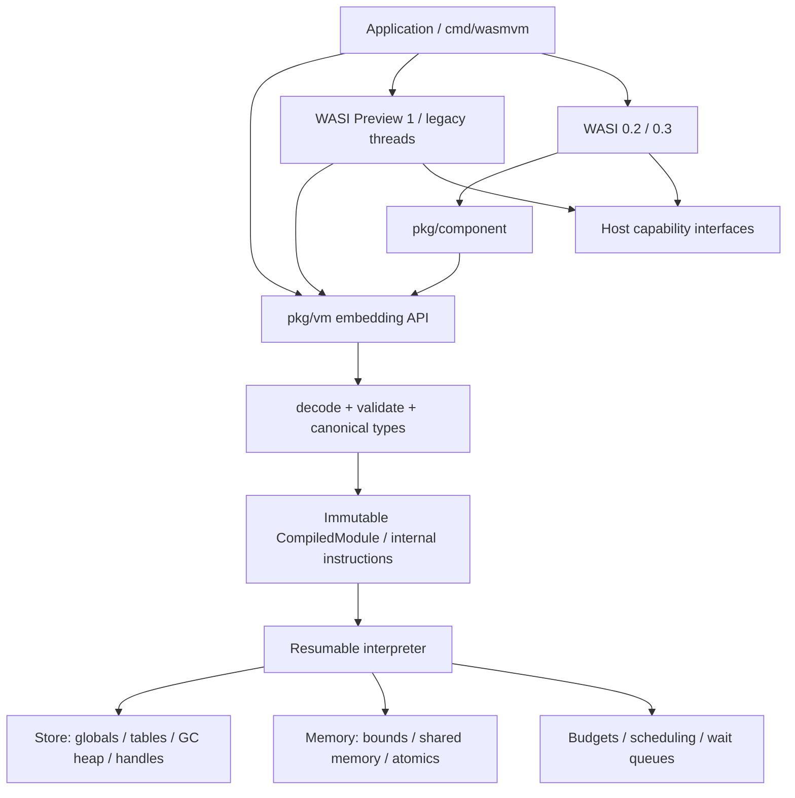

# Architecture

Status: initial design, 2026-10-26. The APIs, types, and behaviors in this document are design constraints, not implemented features. Proposal status and existing implementation capabilities are documented in the [standards survey](../research/standards.md) and [implementation survey](../research/implementations.md), respectively.

Implementation provenance update: [M0 selects reuse of wazero first](reuse-decision.md), with runtime compatibility fixes in LLGo. The independent-engine blueprint below remains a fallback and a source of acceptance contracts, not an instruction to duplicate working decoder/interpreter code. Engine-specific differences must be documented and validated as each milestone is implemented.

## 1. Purpose and scope

`wasmvm` is a Wasm runtime intended for embedding in Go applications, with a CLI also planned. Its initial execution backend is a pure Go interpreter, prioritizing verifiable semantics, bounded resource use, and consistent behavior under Go and llgo. Go or llgo compiles the **host VM** into a native executable, which then loads guest `.wasm` modules. Compiling the VM itself to Wasm is a separate goal and is outside the initial scope.

The M0 experiments with Wago and wazero must precede implementation. This document uses an independent interpreter as the baseline for describing package boundaries. Reusing an existing engine must still satisfy the validation, resource, and compatibility contracts defined here; existing functionality should not be rewritten merely to preserve this draft.

The initial platform targets are Linux and macOS on amd64 and arm64. Required CI checks for both compilers start on Linux amd64, with additional architectures following. Windows, 32-bit hosts, JIT, an AOT compiler, browser hosting, and full POSIX emulation are not initial commitments.

## 2. Layers and data flow



Dependencies always point from protocol adapters toward the core; the core must not import WASI. Decoding, validation, instantiation, and execution are separate steps. A deserialized module cannot execute directly: only a validated internal representation may enter the interpreter.

### Key objects

| Object | Lifetime and concurrency contract |
| --- | --- |
| `Engine` | Feature profiles, type canonicalization, immutable module cache, and shared-memory atomic ordering coordinator; supports concurrent compilation |
| `CompiledModule` | Validated, immutable code and metadata, shareable across Stores; the cache key includes content, feature set, and validator version |
| `Store` | Isolation domain for instances, globals, tables, object handles, and a GC heap; at most one guest continuation executes by default, with no implicit concurrent reentry |
| `Instance` | A module's instantiated state; binds imports, functions, tag identities, memories, and tables; imports across instances require complete type and ownership-domain checks |
| `Execution` | Explicit call frames, operand/reference stacks, budgets, cancellation signals, and exception state; can suspend and resume |
| `Memory` | Linear-memory object, separate from the GC heap; instances share the same shared-memory object through explicit references |
| `ThreadGroup` | Process domain for legacy wasi-threads: parent and child instances, shared memory, exit state, and a synchronized P1 resource table |
| `ComponentInstance` | Component instance, resource table, Canonical ABI configuration, and asynchronous task state |

A Store's single-executor rule does not prevent parallel execution across Stores or ThreadGroup threads. Host callbacks return synchronously by default; asynchronous host calls use explicit suspension. Reentry into the same Store must use a controlled call-stack interface, rather than starting a goroutine from a callback to execute the instance directly. Host Root/Release, Close, and publication of asynchronous results must also enter the Store's serialized state-update domain. GC freezes all guest and host mutators, not just the interpreter loop.

## 3. Binary decoding, validation, and feature profiles

The decoder uses a bounded reader and checks magic/version, LEB128 length and overflow, section order and duplication, index spaces, function-body boundaries, and quotas. Guest-declared lengths must not be converted directly to host `int` values or used for allocation without validation.

The validator maintains control and operand-type stacks, multi-value block signatures, unreachable states, mutability constraints, and reference types. GC requires structural equivalence and canonicalization of iso-recursive type groups, subtype relationships established by explicit supertype declarations, variance, nullable/non-null constraints, type matching, and cast rules. Go type assertions alone cannot implement Wasm type relationships. Equivalence and subtyping follow the [GC type specification](https://github.com/WebAssembly/gc/blob/main/proposals/gc/MVP.md).

FeatureSet is an explicit, immutable configuration whose enabled features include their required dependencies. Presets identify exact specification snapshots. An unimplemented feature produces `UnsupportedFeature` before compilation rather than silently becoming a no-op. Candidate profiles are:

- `core2`: the complete Core 2.0 feature set as a testing target; support remains itemized until the full matrix passes.
- `core3`: Core 3.0, including GC, typed references, tail calls, standard EH, Memory64, multi-memory, and relaxed SIMD.
- `threads`: a separate Core Threads switch; enabling core3 does not imply thread support.
- `llgo-wasip1`: records the exact guest compiler and flags; requires the emitted features, including P1, shared memory, atomics, wasi-threads, standard EH, and SIMD.
- `component-p2` / `component-p3`: separate manifests for component encoding, Canonical ABI, and WASI WIT versions.

Legacy EH, WASIX, Shared-Everything Threads, stack switching, and JSPI are not implicit in these profiles. Adding any of them requires separate configuration, a corresponding specification snapshot, and tests.

## 4. Interpreter and numeric semantics

Decoded internal instructions carry validated immediates, branch targets, and type indices. The interpreter uses an explicit frame stack for calls and returns so guest recursion does not consume the host Go stack. A tail call replaces the current guest frame. The first implementation uses straightforward instruction dispatch; benchmarks must justify subsequent optimizations.

Scalar bit patterns and references are stored separately. i32/i64/f32/f64/v128 use explicit bit representations, while reference slots use typed handles instead of storing pointers in `uint64` or `uintptr`. An initial `v128` implementation can use two `uint64` values and scalar lane operations without host assembly.

Implement Wasm overflow, shift masking, division by zero, signed-division overflow, truncating/saturating conversions, negative zero, NaN, min/max, nearest, and reinterpretation semantics explicitly. Do not assume all Go floating-point defaults match Wasm. Assertions for relaxed SIMD and permitted NaN results check the specification's allowed result sets rather than requiring identical bit patterns across VMs.

Standard EH uses tag instance identity, `exnref`, `try_table`, `throw_ref`, and an explicit guest handler stack. Go `panic/recover` is not the mechanism for guest exceptions. Wasm traps, guest exceptions, WASI errno, WASI exit, host cancellation, and engine defects have distinct outcomes. Panics caused by host programming errors are not swallowed by default.

## 5. Wasm GC and host GC

Three forms of collection must remain distinct:

1. The Go/llgo host GC collects the VM implementation's own Go objects.
2. Wasm GC manages guest `struct`, `array`, and reference objects, providing guest types, identity, casts, field access, and a bounded heap budget.
3. A guest language's own collector inside linear memory, such as the current llgo guest collector, manages objects within byte memory. The VM does not interpret that collector's root tables or equate it with Wasm GC.

The initial design uses an **explicit, nonmoving, stop-the-world mark/sweep guest heap private to each Store**. Object-table handles contain a slot and generation to prevent a stale reference from resolving to a reused slot. The API implementation maintains a Store identity in each handle that callers cannot forge. Host APIs reject direct transfer of references across Stores. Generation overflow retires a slot instead of wrapping and reusing it.

Roots include reference stacks and locals of every suspended or running Execution, globals, tables, active exception payloads, explicit host root scopes, and core references held by component bridges. GC field scanning follows canonical type bitmaps; packed i8/i16 fields are not pointers, and i31 is an immediate value rather than a heap address. Module function references must preserve their instance's lifetime.

Temporary references during allocation are also roots. For example, `struct.new` may pop field references from the operand stack before allocating the object. If those references remain only in Go local variables, the guest collector can incorrectly reclaim their targets. Before every safepoint that may allocate, reenter, or suspend, temporary references must be spilled into an explicit root scope. The runtime roots references returned to the host until handoff completes, after which the public Root/Release contract applies.

Ordinary Go pointers, slices, and interface fields preserve host reachability; host object addresses must not be retained solely as integers. Guest sweep clears Go references from object-table slots so the host GC can eventually reclaim those objects. `externref` holds host references in a controlled handle table, and conversions between `anyref` and `externref` follow the specification. The API promises no host finalizer timing and does not treat `runtime.GC()` as guest collection.

Check guest heap quotas before allocation. Live objects, object tables, and type metadata all count toward quotas, not just payloads. Collection occurs at Store safepoints; continuations suspended in host calls remain subject to root scanning. Collection is allowed only when guest execution is stopped and internal heap updates are complete. The initial collector is neither incremental nor generational, so it does not require barriers for those algorithms. Field writes still pass through heap APIs so barriers can be added later.

Core Threads does not imply a shared GC heap. Each thread instance in this design has an isolated Store and heap, sharing only explicitly designated linear memory and host resources. Shared-Everything Threads adds shared types, tables/globals/GC objects, and memory-model requirements. It needs a separate RFC and cannot be enabled through an existing switch.

## 6. Linear memory and threads

### Memory representation

Address calculations first perform checked addition in `uint64`, then compare against the actual length, and finally check whether the result fits a host `int`. Memory64 changes guest addressing width; it does not require allocating 2^64 bytes. Memory/table growth must respect specification limits, declared maxima, and host quotas. Expected allocation failures return the specified result rather than crashing the process.

Private memory can initially use a contiguous byte slice. The initial shared-memory implementation can also use a locked slice because all access and growth go through Memory methods, and the host receives no long-lived slice or pointer. Growth, copy/fill, and host I/O reads and writes follow the same rule. Segmented storage may replace this representation later while preserving SIMD, unaligned, cross-page, and bulk-operation semantics.

### Portable threading baseline

- Guest threads map to Go goroutines, scheduled onto OS threads by Go/llgo. ThreadGroup quotas bound their number. Blocking host calls and atomic waits must not block the entire engine.
- **Go's data-race rules are stricter than Wasm's.** Ordinary guest loads and stores to shared memory also use synchronized methods. A design with ordinary byte-slice accesses and locks only around atomic opcodes is not acceptable.
- Shared Memory may be imported into another Store only within the same Engine synchronization domain. Cross-domain sharing is rejected; separate Engine locks cannot protect the same memory object. `memory.size` participates in synchronization. `atomic.fence`, which has no memory operand, is ordered within the execution context's synchronization domain even when the module declares no memory.
- The initial correctness backend uses one mutex within the shared-memory synchronization domain for atomic operations and shared-byte accesses, establishing atomic ordering across memories. It must not mix Go atomic operations through `unsafe` pointers of different widths. Test non-atomic access granularity and permitted tearing against the Threads specification; the litmus suite must confirm that the baseline's stronger synchronization is acceptable.
- Memory-access critical sections must be short. `memory.atomic.wait32/64` checks the expected value and registers a waiter keyed by `(memory identity, address)` within the same synchronization domain, then releases the lock before waiting to avoid lost wakeups. Results distinguish not-equal, timed-out, and ok. A negative timeout means an indefinite wait as specified, and `notify` wakes only the specified number of matching waiters.
- Test interactions among `memory.grow`, ordinary accesses, bulk operations, atomics of different widths, fences, and multiple shared memories together. Stronger ordering caused by scheduling does not remove alignment-trap or bounds-check requirements.
- Use Go's race detector to check the host implementation, not as proof of the Wasm memory model.

Wait queues must arbitrate completion exactly once against cancellation, thread exit, process exit, and Store close, leaving no orphaned waiters, duplicate wakeups, or deadlocks. Cancellation returns an engine-interruption result rather than masquerading as a normal Wasm wait result. Check budgets at loops/backedges, calls, allocations, and chunks of large operations. The API contract must identify arbitrary user host callbacks that cannot be preempted, and built-in adapters must support cancellation.

### Legacy wasi-threads adapter

`pkg/wasi/threads` separately implements `wasi.thread-spawn` and the guest `wasi_thread_start(tid, arg)` protocol. It is not part of the standard Preview 1 export set. Child instances reuse the same CompiledModule and import the same shared memory, while maintaining separate stacks, TLS, and locals. Child threads invoke the ABI entry point rather than rerunning the process `_start` function.

Validate child-instance initialization, data-segment replay, SDK stack/TLS initialization, and thread-id rules against pinned wasi-threads/wasi-libc versions and llgo fixtures. Ordinary Instantiate must not be assumed safe for this purpose. Where instantiation has side effects, provide an explicit child-thread initialization path. ThreadGroup shares locked fd/preopen/exit state. Handle the process lifecycle for `proc_exit`, main-thread exit, and exceptions according to the adapter protocol, rolling back resources on initialization failure.

## 7. WASI and the Component Model

Host capabilities use explicitly injected clock, random, filesystem, stdio, network, and poll interfaces. Directories, networking, environment variables, host process arguments, and other ambient privileges beyond real-clock access are not exposed by default; the exact default capability set will be finalized during API implementation. Tests use virtual clocks, deterministic random sources, and in-memory filesystems.

Preview 1 implements the `wasi_snapshot_preview1` linear-memory ABI precisely: little-endian encoding, pointers/lengths, iovec, errno, rights, fd lifetimes, and `poll_oneoff`. Capability directory handles enforce directory boundaries. String-prefix checks alone cannot prevent escapes through `..`, symbolic links, or TOCTOU races. Differences in host capabilities must produce the appropriate errno values.

WASI 0.2 is not a renaming of P1 functions. It requires component binaries, WIT types, Canonical ABI lift/lower, string encodings, realloc/post-return, resource own/borrow, drop, and component composition. Start with CLI worlds pinned to a WIT version, then extend to filesystem, sockets, and HTTP. Running components does not establish support for all WASI interfaces.

WASI 0.3 adds `async func`, `stream<T>`, `future<T>`, and component-level task scheduling, cancellation, and backpressure requirements. P2 pollables and P3 native async require separate adapters. This design reserves suspendable Execution objects and an independent scheduler, but the complete canonical async ABI requires dedicated design work in M5. Async is not equivalent to Core Threads and does not require implementing the Core stack-switching proposal first.

The initial WIT parser/code generator can run as an external development tool rather than being embedded in the production VM. The runtime accepts only validated, version-pinned generated metadata. P1-to-component adapters may reuse official toolchain artifacts, but they do not replace this project's component execution capability.

## 8. Embedding API shape (draft)

The following illustrates lifetimes only; **it is not a currently compilable API**:

```go
engine, err := vm.NewEngine(vm.Config{Features: profile, Limits: limits})
defer engine.Close()
compiled, err := engine.Compile(ctx, wasmBytes)
store, err := engine.NewStore(storeConfig)
defer store.Close(ctx) // Cancel execution, wake waits, await exit, close resources.
linker := vm.NewLinker(engine)
err = preview1.Register(linker, capabilities)
instance, err := linker.Instantiate(ctx, store, compiled)
result, err := instance.Call(ctx, "_start")
```

Real callers must check every error; those branches are omitted here. Host function bindings use explicit signatures and typed `Value` objects, without default reflection-based inference from Go function signatures. Host memory access uses bounded copy-in/copy-out or short-lived borrows; shared memory exposes no raw slice. Persistent external references use explicit Root/Release interfaces, with documentation explaining the memory-retention consequences of not releasing them.

Errors distinguish at least DecodeError, ValidationError, UnsupportedFeature, LinkError, Trap, GuestException, ExitError, ResourceLimit, and Canceled. They include module/function/byte-offset information or a guest stack. Expected failures must not all be flattened into strings.

## 9. Resource control and testing

Each Store/ThreadGroup explicitly limits module/function/type counts, nesting depth, code size, memory pages, table elements, live GC objects, host resources, threads, guest stacks, execution fuel, and wall-clock deadlines. Reclamation, close, and cancellation must be idempotent. Report the `Close` waiting limit separately from external callbacks that cannot be canceled.

The validator and interpreter primarily use the official `.wast` suite from the same specification snapshot. Pinned tools convert WAST into committed fixtures or deterministic JSON/wasm artifacts; test execution must not depend on a developer's private tool paths. Failures retain the fixture, feature set, toolchain versions, and random seed. Differential execution uses the common capability subsets of Wasmtime, Wago, and wazero. Judge NaN, relaxed SIMD, and nondeterministic threaded outcomes by the specification rather than treating stdout equality as a universal oracle.

Fuzzing covers decoding, validation, type graphs, instantiation rollback, and host ABIs. Concurrency tests cover lost wait/notify wakeups, timeout/notify/cancel races, access during growth, mixed-width atomics, thread-spawn failures, and process exit. GC tests force collection at every allocation point and cover cycles, roots across host calls, exception-stack roots, and host-handle release.

Both compilers execute the same semantic and fixture suites. Go-only `-race` and fuzz runs provide additional diagnostics. Before claiming a feature is supported, record the specification version, feature switches, passed-case counts, explicit skip reasons, and results from both compilers.

## 10. Current decisions and open validation work

| Decision | Reason | Revisit when |
| --- | --- | --- |
| Pure Go interpreter first | Simplifies portability across both compilers and semantic checks | M0 establishes whether Wago/wazero can supply the engine |
| Explicit guest GC with host-visible references | Provides stable object identity, guest quotas, and controlled roots | GC stress benchmarks justify generational/incremental collection |
| Fully synchronized shared-memory backend | Avoids Go races, unsafe access, and architecture-specific behavior | Threads tests and performance baselines are complete |
| Store-private GC heaps | Matches the current Core Threads boundary | A separate Shared-Everything Threads RFC is accepted |
| Versioned WASI packages and separate threads adapter | Keeps legacy extensions distinct from stable standards | WIT/specification versions change |
| Explicit continuation stacks | Supports tail calls, budgets, and future P3 suspension | The P3 Canonical ABI spike |
| Defer JIT | Limits coupling to host runtime and compiler ABIs | The interpreter is functionally complete and real benchmarks justify it |

Open questions include whether Wago can compile directly with llgo; the stability of wazero's experimental APIs; throughput of the serialized shared-memory backend; the cost of fully validating WASI 0.3 canonical async; portable capability-directory implementations across hosts; and licenses and version pinning for official tests and tools. The [roadmap](../roadmap.md) turns these questions into tasks with acceptance criteria.
