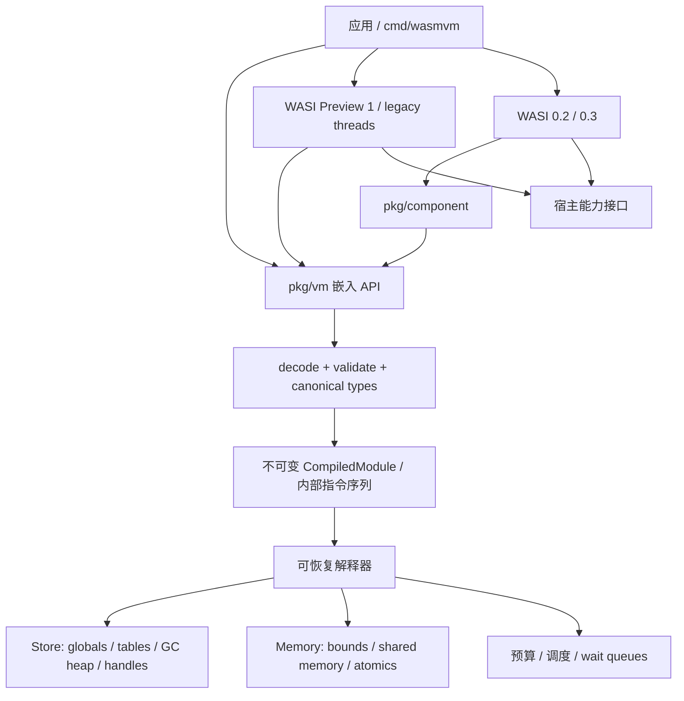

# 总体架构

状态：初始设计，2026-10-26。本文中的 API、类型与行为是设计约束，尚未实现。提案状态与实现能力分别以[标准调研](../research/standards.md)和[实现调研](../research/implementations.md)为依据。

## 1. 定位与范围

`wasmvm` 是可嵌入 Go 程序的 Wasm 运行时，也计划提供 CLI。首个执行后端是纯 Go 解释器，追求可验证语义、资源可控及 Go/llgo 一致性。Go 或 llgo 将**宿主 VM**编译为本机程序，VM 再加载 guest `.wasm`；这与“把 VM 本身编译为 Wasm”是两个目标，后者不纳入首期。

正式实现前必须完成 M0 的 Wago/wazero 实测。本文采用独立解释器基线描述包边界；如果复用现有内核，仍需满足这里的验证、资源与兼容性契约，不为了保持草案而重写已有能力。

第一阶段支持 Linux/macOS 的 amd64/arm64；首先在 Linux amd64 上建立两种编译器的阻断式 CI，然后扩展架构。暂不承诺 Windows、32 位宿主、JIT、AOT 编译器、浏览器宿主和完整 POSIX 仿真。

## 2. 分层与数据流



依赖始终从协议适配层指向核心；核心不能导入 WASI。解析、验证、实例化、执行必须是分离步骤。反序列化得到的模块不能直接执行，只有验证成功的内部表示可进入解释器。

### 关键对象

| 对象 | 生命周期与并发契约 |
| --- | --- |
| `Engine` | feature profile、类型规范化、不可变模块缓存、共享内存原子序协调器；可以并行编译 |
| `CompiledModule` | 验证完成的只读代码/元数据，可被多个 Store 共享；缓存键包含内容、feature set、验证器版本 |
| `Store` | 实例、globals、tables、对象句柄和 GC 堆的隔离域；默认最多一个 guest continuation 执行，禁止隐式并发重入 |
| `Instance` | 模块的实例态；绑定导入、函数、tag 身份、内存与表；跨实例导入需检查完整类型及所属域 |
| `Execution` | 显式调用帧、operand/reference 栈、预算、取消信号、异常状态；可挂起恢复 |
| `Memory` | 线性内存对象，独立于 GC 堆；shared 实例通过显式引用共享同一对象 |
| `ThreadGroup` | legacy wasi-threads 的进程域：父子实例、共享内存、退出状态及受同步保护的 P1 资源表 |
| `ComponentInstance` | 组件实例、resource table、canonical ABI 配置及异步 task 状态 |

Store 的“单执行者”不禁止多个 Store/ThreadGroup 线程真正并行。Host callback 默认同步返回，异步 host call 使用显式 suspension；同一个 Store 内重入必须通过受控调用栈接口，不能从回调另启 goroutine 直接执行实例。宿主的 Root/Release、Close 和异步结果发布也必须串行进入 Store 的状态更新域；GC 冻结所有 guest 与 host mutator，不能仅暂停解释器循环。

## 3. 二进制、验证器和 feature profiles

解析器使用有界 reader，验证魔数/版本、LEB128 长度和溢出、section 顺序/重复、索引空间、代码体边界及配额。不能把 guest 声明长度直接转换为宿主 `int` 或预分配。

验证器维护控制栈、操作数类型栈、多值 block signature、不可能到达状态、可变/不可变约束和引用类型。GC 要求 iso-recursive 递归类型组的结构等价与规范化、通过显式 supertype 声明建立子类型关系、variance、nullable/non-null、类型匹配和 cast 规则；不能只靠 Go 类型断言实现 Wasm 的类型关系。具体等价与子类型边界以 [GC 类型规范](https://github.com/WebAssembly/gc/blob/main/proposals/gc/MVP.md)为依据。

FeatureSet 是不可变显式配置，遵循依赖闭包。预设按精确规范快照命名；未实现的 feature 在编译前返回 `UnsupportedFeature`，不能静默当作 no-op。设计中的候选 profile：

- `core2`：Core 2.0 功能的完整测试目标；未通过完整矩阵前只公布逐项支持。
- `core3`：Core 3.0，包括 GC、typed refs、tail calls、标准 EH、Memory64、multi-memory、relaxed SIMD 等。
- `threads`：独立 Core Threads 开关；不能因为 core3 就自动声称支持线程。
- `llgo-wasip1`：精确记录 guest 编译器及 flags；要求 P1、shared memory、atomics、wasi-threads、标准 EH、SIMD 等实际生成特性。
- `component-p2` / `component-p3`：独立组件编码/Canonical ABI/WASI WIT 版本清单。

Legacy EH、WASIX、Shared-Everything Threads、stack switching、JSPI 均不隐含在上述 profile 中。后续纳入必须有独立配置、对应规范快照和测试。

## 4. 解释器与数值语义

解码后的内部指令记录已验证的立即数、跳转目标和类型索引。解释器用显式 frame 栈执行调用和返回，避免 guest 递归消耗宿主 Go 栈；tail call 替换当前 guest frame。首版采用简单指令分发，性能优化以基准为依据。

值的标量位模式和引用分开存储：i32/i64/f32/f64/v128 使用明确的位表示；reference slot 使用类型化句柄，不把指针写入 `uint64`/`uintptr`。`v128` 可先用两个 `uint64` 及标量 lane 操作实现，无须宿主汇编。

明确实现 Wasm 的溢出、移位掩码、除零、signed division overflow、截断/饱和转换、负零、NaN、min/max、nearest 与重解释语义。不能直接依赖所有 Go 浮点运算的默认细节。relaxed SIMD 和规范允许的 NaN 结果集合由断言器按允许集合判断，不要求跨 VM 位模式完全相同。

标准 EH 使用 tag 实例身份、`exnref`、`try_table`、`throw_ref` 和显式 guest handler 栈；不使用 Go `panic/recover` 承载 guest 异常。Wasm trap、guest exception、WASI errno、WASI exit、宿主取消和引擎缺陷分别返回不同结果。默认不吞掉宿主程序 bug 的 panic。

## 5. Wasm GC 与宿主 GC

三层回收必须区分：

1. Go/llgo 宿主 GC 回收 VM 自身的 Go 对象。
2. Wasm GC 管理 guest `struct`/`array`/引用对象，提供 guest 类型、身份、cast、字段访问和可控堆预算。
3. guest 语言自行在 linear memory 内实现的 GC（例如当前 llgo guest）管理字节内存里的对象；VM 不解析其根表，也不把它等同于 Wasm GC。

首版计划采用 **Store 私有、非移动、stop-the-world 的显式 mark/sweep guest heap**。对象表使用槽位 + generation 的句柄，防止槽位复用导致 stale reference 被误识别。句柄携带由封装层维护的 Store 身份，调用方不能伪造；跨 Store 的 host API 拒绝直接搬运引用。generation 溢出应退役槽位，而非回绕复用。

根集合包括所有暂停/运行的 Execution 引用栈、locals、globals、tables、活跃 exception payload、显式 host root scope 和组件桥接持有的核心引用。GC 字段扫描根据 canonical type bitmap，packed i8/i16 字段不能被当作指针；i31 是立即值而非堆地址。模块函数引用需保留实例生命周期。

分配期间的临时引用也是根。例如 `struct.new` 把字段引用弹出 operand stack 后再分配对象，引用若仅留在 Go 局部变量，guest collector 仍可能误回收它。所有可触发分配、重入、挂起的 safepoint 前必须把临时引用 spill 到显式 root scope；返回给 host 的引用在交接完成前由运行时持根，之后遵守公开 Root/Release 契约。

宿主可达性通过普通 Go 指针/切片/interface 字段保留；不能只把宿主对象地址编码为整数。guest GC 完成 sweep 时清理对象表中的 Go 引用，宿主 GC 才能真正回收相应对象。`externref` 在受控句柄表中持有宿主引用，`anyref`/`externref` 转换遵循规范；不承诺宿主 finalizer 的执行时间，也不把 `runtime.GC()` 当作 guest GC。

分配前先核对 guest heap 配额；存活对象、对象表和类型元数据均计入配额，不能只统计 payload。单 Store 收集在 safepoint 发生；被 host call 挂起的 continuation 仍需被扫描。只有当前不执行 guest 且所有内部 heap 更新完成后，才能回收。首版不实现 incremental/generational GC，因而不需要为其提前引入写屏障；字段写入仍集中在 heap API，方便未来插入屏障。

Core Threads 不允许由此推导出共享 GC 堆。当前每个线程实例拥有隔离 Store/heap，只显式共享 linear memory 和宿主资源。Shared-Everything Threads 涉及共享类型、表/全局量/GC 对象及内存模型，需另行 RFC，不能打开现有开关获得。

## 6. 线性内存与线程

### 内存表示

所有地址计算先用 `uint64` 做 checked-add，再与实际长度比较，最后检查能否转为宿主 `int`。Memory64 改变 guest 寻址宽度，并不意味着要实际分配 2^64 字节。memory/table grow 必须满足规范上限、声明 max 和宿主配额，失败走规范结果，不把预期分配失败变成进程崩溃。

private memory 可先用连续 byte slice；shared memory 首版也可使用受锁保护的 slice，因为所有访问及 grow 均经过 Memory 方法，并且不向 host 暴露长期有效的 slice 或指针。扩容、copy/fill、host I/O 读写也必须遵守同一规则。后续可换分段存储，但 SIMD、unaligned、跨页和 bulk 操作要保持语义。

### 可移植线程基线

- guest 线程映射为 Go goroutine，由 Go/llgo 调度到 OS 线程；线程数量受 ThreadGroup 配额约束。阻塞 host call 和原子 wait 不得占住整个引擎。
- **Go 数据竞争规则比 Wasm 更严格**。guest 对 shared memory 的普通 load/store 也经过同步方法，不能使用“普通读写 byte slice + 只有 atomic opcode 加锁”的实现。
- shared Memory 只能在同一 Engine 的同步域内导入到其他 Store，跨域共享直接拒绝；否则不同 Engine 的锁不能保护同一个内存对象。`memory.size` 参与同步；没有 memory operand 的 `atomic.fence` 也在执行上下文所属同步域排序，包括模块本身未声明 memory 的情况。
- 首个正确性后端使用共享内存同步域中的统一互斥锁，覆盖原子操作及共享字节读写，建立跨内存的原子顺序；不得依靠不同宽度 `unsafe` 指针混用 Go atomic。非原子访问的粒度与允许撕裂行为按 Threads 规范测试，首版更强同步的可接受性需由 litmus suite 确认。
- 内存读写临界区必须短。`memory.atomic.wait32/64` 在同一同步域内检查期望值并登记 `(memory identity, address)` waiter，随后释放锁再等待，避免丢失唤醒。返回值区分 not-equal / timed-out / ok，负超时按规范表示无限等待；`notify` 只唤醒规定数量的匹配 waiter。
- `memory.grow`、普通访存、bulk 操作、不同宽度 atomics、fence 以及多个 shared memory 的交互必须统一测试。即使调度导致更强顺序，也不能漏掉对齐 trap 和越界规则。
- 将 Go race detector 作为宿主实现检查，不能据此声称证明了 Wasm memory model。

等待队列必须与取消、thread exit、process exit 和 store close 进行一次性完成仲裁，保证无遗留 waiter、重复唤醒或死锁。取消返回引擎中断结果，不伪造成某个正常 Wasm wait 返回值。预算在 loop/backedge、call、分配和大块操作分段处检查；无法抢占的任意用户 host callback 必须在 API 契约中明确，并提供可取消内建适配器。

### legacy wasi-threads 适配

`pkg/wasi/threads` 独立实现 `wasi.thread-spawn` 与 guest `wasi_thread_start(tid, arg)` 协议，不把它放进 Preview 1 标准导出集合。复用同一 CompiledModule 创建子实例，导入同一 shared memory，使用独立 stack/TLS/locals，子线程按 ABI 调用入口而非重复运行进程 `_start`。

子实例初始化、data segment 重放、SDK 栈/TLS 初始化和 thread-id 规则需以 pinned wasi-threads/wasi-libc 及 llgo fixture 验证；不能假设普通 Instantiate 就天然安全。实例化产生副作用时应提供明确的子线程初始化路径。ThreadGroup 共享受锁保护的 fd/preopen/exit 状态；`proc_exit`、主线程退出和异常的整个进程生命周期按适配协议处理，并对初始化失败回滚资源。

## 7. WASI 与 Component Model

宿主能力使用明确注入的 clock、random、filesystem、stdio、network 和 poll 接口。默认不开放目录、网络、环境变量、宿主进程参数或真实时钟以外的隐含权限；具体默认能力在 API 实现阶段定稿。测试使用虚拟时钟、确定性随机源和内存文件系统。

Preview 1 精确实现 `wasi_snapshot_preview1` 的线性内存 ABI：little-endian、指针/长度、iovec、errno、rights、fd 生命周期及 `poll_oneoff`。使用 capability directory handle 实现目录约束，不能仅靠字符串前缀校验阻止 `..`、符号链接与 TOCTOU 越界。宿主系统能力不同应明确返回对应 errno。

WASI 0.2 不是把 P1 函数换名：需要组件二进制、WIT 类型、Canonical ABI 的 lift/lower、字符串编码、realloc/post-return、resource own/borrow、drop 与组件组合。先支持一组锁定 WIT 版本的 CLI 世界，再扩展 filesystem、sockets、HTTP；不得因为“可运行组件”就声明全部 WASI 接口已支持。

WASI 0.3 在组件层增加 `async func`、`stream<T>`、`future<T>` 及 task 调度/取消/backpressure 等约束。P2 pollable 和 P3 原生异步要有不同适配；本阶段预留可暂停的 Execution 和独立 scheduler，但完整的 canonical async ABI 必须在 M5 专门设计。async 不等同于 Core Threads，也不要求先实现 Core stack-switching proposal。

WIT parser/codegen 初期可作为外部开发工具运行，不嵌入生产 VM；运行时只接受经过验证并锁定版本的生成元数据。P1→component adapter 可以复用官方工具链产物，不能替代本项目的组件执行能力。

## 8. 嵌入 API 形状（草案）

以下仅展示生命周期，**不是当前可编译 API**：

```go
engine, err := vm.NewEngine(vm.Config{Features: profile, Limits: limits})
defer engine.Close()
compiled, err := engine.Compile(ctx, wasmBytes)
store, err := engine.NewStore(storeConfig)
defer store.Close(ctx) // 取消执行，唤醒 waits，等待退出，关闭资源
linker := vm.NewLinker(engine)
err = preview1.Register(linker, capabilities)
instance, err := linker.Instantiate(ctx, store, compiled)
result, err := instance.Call(ctx, "_start")
```

实际 API 要求检查每一步 error；此处省略处理分支。host 函数绑定采用显式 signature 与 typed `Value`，不默认使用 reflect 按 Go 函数签名自动推导。host 获取内存采用有界 copy-in/copy-out 或短作用域 borrow，shared memory 不暴露裸 slice。外部持久引用通过显式 Root/Release 接口，文档说明未 Release 的内存保留后果。

错误至少区分 DecodeError、ValidationError、UnsupportedFeature、LinkError、Trap、GuestException、ExitError、ResourceLimit、Canceled，并带 module/function/byte offset 或 guest stack。不能把预期错误全部转换成字符串。

## 9. 资源控制与测试

每个 Store/ThreadGroup 显式限制模块/函数/类型数量、嵌套深度、代码大小、内存页、表元素、GC 活对象、host resources、线程数、guest stack、执行 fuel 和 wall deadline。回收、关闭和取消要求幂等；`Close` 等待上限和无法取消的外部 callback 分开报告。

验证器与解释器以同一规范 snapshot 的官方 `.wast` suite 为主；固定工具将 WAST 转换为可提交的测试夹具或确定性 JSON/wasm，测试执行不能依赖开发者的私有工具路径。失败时保存 fixture、feature set、工具链版本和随机种子。差分执行参考 Wasmtime/Wago/wazero 的共同能力子集，对 NaN/relaxed SIMD/线程非确定结果采用规范判定，不使用简单 stdout 相等覆盖所有场景。

模糊测试覆盖解码、验证、类型图、实例化回滚和 host ABI。并发测试涵盖 wait-notify 丢唤醒、timeout/notify/cancel 竞争、grow 同时访存、mixed-width atomics、thread-spawn 失败和进程退出。GC 测试在每个分配点强制收集，覆盖环、跨 host call 根、异常栈根及 host 句柄释放。

两种编译器跑相同的语义/fixture suite；Go 专属 `-race`/fuzz 属于额外诊断。正式支持某项功能前，须同时记录规范版本、功能开关、已通过的用例数、明确 skip 原因及两种编译器结果。

## 10. 当前决策与待验证项

| 决策 | 原因 | 何时重审 |
| --- | --- | --- |
| 纯 Go 解释器优先 | 便于两编译器移植和语义检查 | M0 若 Wago/wazero 可复用则调整内核来源 |
| 显式 guest GC + 宿主可见引用 | 支持稳定对象身份、guest 配额与可控根集合 | GC 压力基准显示需分代/增量时 |
| 全同步 shared-memory 后端 | 避免 Go race/unsafe/架构差异 | Threads suite 与性能基线完成后才优化 |
| Store 私有 GC 堆 | 匹配当前 core threads 的能力边界 | Shared-Everything Threads 独立 RFC |
| WASI 分版本包，threads 独立 | 避免 legacy 扩展与稳定标准混淆 | WIT/规范版本升级时 |
| 显式 continuation 栈 | 支持 tail calls、预算及未来 P3 挂起 | P3 Canonical ABI spike |
| JIT 暂缓 | 降低运行时与编译器 ABI 耦合 | 解释器功能完整且真实基准证明需要时 |

开放问题：Wago 能否直接用 llgo 编译；wazero 实验特性的 API 稳定性；共享内存串行后端的实际吞吐；WASI 0.3 canonical async 完整验证成本；安全目录能力在各宿主系统的可移植实现；官方测试许可证和工具固定方式。路线图将这些问题安排为可验收任务。
