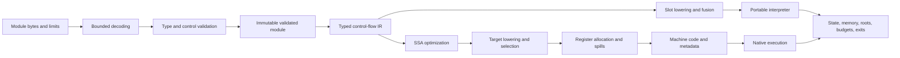

# Core Compiler and Execution Design

Date: **2026-10-26**. Status: **implementation contract, not implemented capability**. This is the core mechanism supplement to the [architecture](architecture.md), [native ABI](native-abi.md), and [performance contract](performance-contract.md).

## Complete profiles and common pipeline

The first acceptance profile is the complete **Core 2.0 binary execution and embedding contract**, using `WebAssembly/spec` commit `fffc6e12fa454e475455a7b58d3b5dc343980c10` (`wg-2.0`), including `test/core` and `test/core/simd`. It includes all scalar instructions and conversions, structured control flow, calls and indirect calls, globals, memories, multiple tables, reference types, multi-value/block parameters, sign extension, nontrapping conversions, bulk memory/table operations, passive/declarative segments, and fixed SIMD. Text parsing uses pinned development tooling; a native WAT parser and the JavaScript API are not VM requirements.

Later profiles add the full pinned Core 3.0 binary scope, including recursive types/WasmGC, typed function references, tail calls, final EH, extended constants, Memory64/**Table64**, multi-memory, and relaxed SIMD. Core Threads remains a separate profile switch. Every enabled feature must be implemented in the selected backend before compilation succeeds. A declaration, decoded opcode, or interpreter-only implementation does not establish native support.

`Compile` validates and prepares the requested backend. Interpreter compilation means decoding/validation and bytecode lowering; native compilation means generating **host CPU machine code from guest Wasm**. Building the VM with Go or LLGo is a separate compilation step. No external LLVM optimizer or Rust/C++ Wasm compiler is required for the planned native path.

## Frontend and validated module

Bound module bytes, section/vector sizes, function bodies, locals, nesting, and all intermediate allocations before allocating. Check LEB widths, integer overflow, UTF-8 names, section ordering/uniqueness, index spaces, function/code agreement, and instruction/immediate boundaries. Retain source offsets for diagnostics. Malformed encoding, invalid typing, disabled/unsupported feature, and resource exhaustion have distinct errors. Declared maxima never override host quotas.

The validator implements operand and control stacks, stack polymorphism in unreachable code, block inputs/results, branch arity, mutability, import/export types, constant expressions, segment rules, and feature dependencies. Parsing does not grant permission to execute. Only validator-produced immutable modules can enter lowering or instantiation. Reference types and signatures are canonical identifiers, with Store ownership checked separately at runtime.

Instantiation resolves every import, checks Engine/Store/type domains and limits, allocates state, validates initializer/data/element ranges, and executes the start function with the ordinary execution budget. Failure releases allocations and references created by the attempt. Side effects already performed on imported memory, tables, or by host functions follow the specification and are **not** transactionally rolled back. Preserve declaration and initialization order; do not run a start function during compilation or benchmark setup while claiming it is excluded.

## Typed control-flow IR

Use basic blocks with typed parameters, explicit branch edges and argument lists, and values identified by dense indexes. Lower the validated operand stack into SSA value identities; retain mutable locals through explicit local operations initially, then promote eligible locals through a verified pass. Block parameters express merges; branches and parallel copies must handle cyclic moves. A verifier checks dominance, types, block arity, terminators, source locations, and definitions after each transforming pass in tests/debug builds.

Each operation records effects: reads/writes to a particular state domain, potential trap, host call, allocation, suspension, and original Wasm fuel charge. Memory operations identify the memory and address width; table operations identify the table and index width. Calls distinguish direct, indirect, host, and later tail calls. Keep numeric values and reference handles typed throughout lowering; never erase references into anonymous scalar spill slots.

Do not fold a trapping expression into a compile-time module rejection when the specification traps only upon execution. Dead-code removal, common-subexpression elimination, constant folding, bounds-check elimination, and inlining must preserve observable effects, trap order, permitted floating-point outcomes, and resource policy. No unsafe fast-math. Preserve source maps from generated instructions to guest operations for traps, traces and metering.

Resource policy is part of compilation configuration and the cache key. With deterministic fuel enabled, charge original Wasm instructions at their semantic boundaries, before their effects. Fused instructions retain sub-operation costs and exits. Coarse prepaid blocks are allowed only where identical exhaustion/side-effect behavior is proved; otherwise retain finer checks or use a separately named budget mode. Optimizing away a loop must not erase its configured fuel exhaustion behavior. Cancellation polling is a separate bounded-latency contract.

### Implemented IR contract

`internal/compiler/lower` lowers every statically valid Core 2.0 function to
`internal/compiler/ir`. Instruction schemas come from the validator's typed
walk; there is no duplicated opcode typing table. Sources retain byte offsets,
immediates, effects and input/output types. Mutable locals remain explicit.
Control edges carry ordered tuples, and unreachable blocks/values are removed
without executing or folding trapping operations.

The verifier checks single definitions, dominance, use order, function/local
types, operand and edge types, terminators, reachability and effect metadata.
It uses iterative traversal and bounded dominance work. Node and verification
budgets apply across the whole module; zero is a literal zero budget. Source
schemas are internal trusted compiler data, not a serialized input format.

Fuel model version 1 charges one unit before each executed Wasm instruction,
except `else` and `end` delimiters. Compiler-generated transfers have no extra
charge. A loop header is charged on entry from outside; a backedge charges its
branch and the subsequent body instructions. These costs are retained in IR;
runtime metering and cancellation are subsequent implementation work.

## Interpreter lowering and hot loop

Lower SSA values and locals into reusable typed slots with precomputed frame sizes. Resolve branches, function indexes, local offsets, immediates, memory offsets and stack effects at compile time. Keep immutable instruction arrays compact and contiguous. A separate read-only pool holds uncommon wide immediates/branch tables. Dispatch uses a Go `switch`; ordinary Go has no portable computed-goto contract. Do not implement dispatch through per-op closures, reflection, or `interface{}` values.

The execution hot loop uses a program counter, explicit frame base and slot arrays. Scalar slots hold exact bit patterns; reference slots hold checked handles with type/root metadata. Frame allocation, locals, outgoing arguments, results, and spill areas use pre-sized storage, growing only at explicit checked boundaries. Guest calls push explicit frames rather than recursively calling Go. Return and `br_table` copy overlapping tuples correctly. Preserve suspended frame state across host calls and resume.

Start with a simple verified lowering. Measure register/slot dispatch against a predecoded stack-dispatch prototype using identical complete semantics. The default design is slot bytecode; change it only with measured evidence covering both compilers, dispatch cost, bytecode size, compile latency, and representative workloads. Do not maintain two permanent production interpreters merely to preserve the experiment.

Optimize demonstrated bottlenecks with direct local/constant forms, copy elimination, block layout, and bounded superinstructions. Fusion must preserve fuel, trap locations, memory effects and safepoints. Pre-resolve internal direct calls; indirect calls retain null, bounds, signature, ownership, and instance checks. Poll at calls, backedges and a maximum straight-line work interval; chunk bulk operations. An unmetered mode still observes cancellation and resource limits. There is no unchecked performance mode for untrusted guests.

Keep allocation out of warmed numeric execution after frames/results are reserved. API allocations, growth and host callbacks are measured separately. Private linear memory can use inlined checked access after profiling; shared memory must retain the common synchronization contract. Check address-plus-offset overflow before bounds and host-index conversion. Preserve the specified failure result for expected grow failures.

## Native compilation

The complete native pipeline is: typed IR verification, optimization, legalization to target operations, instruction selection, register allocation, spill insertion, frame layout, branch resolution/relocations, code emission, and publication with trap/safepoint/source maps. Implement amd64 and arm64 emitters in Go. The baseline uses linear-scan allocation with separate integer/vector classes, fixed-register constraints, call clobbers, live-range splitting, parallel-move resolution, and verified spill reloads. Target tests check actual execution as well as encoding/disassembly.

Use the platform's accepted baseline CPU feature set, with explicit detection and recorded features for optional instructions. Specialized artifacts cannot run on a weaker CPU. Floating-point/vector operations require correct Wasm NaNs, signed zero, rounding, conversions and lane behavior. Division and conversion instructions often need explicit prechecks; host instruction traps and language overflow behavior are not automatically Wasm semantics.

Initially emit explicit memory/table/stack bounds checks and explicit trap exits. Signal-handler recovery is not the default safety mechanism. Eliminate checks only with validated range/effect proofs covering growth, calls, 64-bit overflow and aliases. Imported or mutable function/table targets cannot be treated as immutable without valid guards. Mark the entire profile supported only when each operation has verified native lowering or a documented runtime helper with the same semantics; helper use is reported in performance evidence. Native execution must never interpret an unsupported function silently.

Use a private guest ABI with explicit VM frames: guest calls push checked logical frames and branch to native callee labels; returns branch to saved continuations. The initial backend keeps one bounded C entry frame, without hardware-stack switching or a native C/Go frame per guest call. Host interaction, collection, cancellation and traps leave through the explicit status protocol in the [native ABI](native-abi.md). Whole-function inlining and more advanced optimization follow correctness and profiling; both disabled and enabled optimizations must pass differential tests. A persistent AOT/cache file format is later work; generating native code in-process is required in M2.

## Runtime, lifecycle and observability

Both backends use the same Engine/Store/Instance ownership model, memory/table/heap domains, host signature checks and typed outcomes. Compiled artifacts are immutable and reference counted or otherwise retained until all instances and active/suspended executions release them. Closing an Engine prevents new work and cannot unmap code used by a continuation. Store `Close` is an idempotent, nonblocking close request: prevent new work, signal cancellation and resolve waits once, then reclaim after active callbacks/executions leave. It is safe from a host callback and never joins itself. A separate `WaitClosed(ctx)` is for an external caller to await reclamation with a deadline; calling it from an active callback of that Store is outside its contract. Host-boundary deferred cleanup releases reentry tokens, temporary roots and execution/code leases before propagating a host panic, allowing the caller to recover without leaving a busy Store. An arbitrary blocking user callback remains outside any promised preemption bound.

Define explicit exits for return, host request, trap, budget exhaustion, cancellation, allocation/growth, and suspension; later add exception and async state without using Go panic as guest control flow. Root maps cover active and suspended frames, locals, temporaries, host handles and exception payloads. Every collection/reentry boundary spills live guest references before allocation or entering the host. Keep Go objects rooted in Go-managed tables; machine registers and native stacks contain handles rather than sole copies of host pointers.

Debugging must retain module/function/byte-offset and guest stack information without depending on native PC readability after code is freed. Benchmark phase timers wrap actual API or internal phase intervals; phases that overlap through lazy compilation/tiering are reported as such. The first backend is eagerly compiled with tiering disabled, so first-call and warmed-call costs have clear meaning.

## Tests and completion evidence

| Layer | Required checks |
| --- | --- |
| Decode/validate | Complete pinned profile tests including malformed/invalid/unlinkable inputs; truncation/LEB/allocation fuzzing; no panics for hostile bytes |
| IR/optimization | Verifiers; branch/tuple/loop cases; differential optimized/unoptimized execution; fuel, trap and side-effect order; legal NaN outcome sets |
| Interpreter | Every opcode and trap; explicit frame/stack limits; host reentry, growth and cancellation; full Core 2.0 corpus |
| Native | Same corpus on both CPUs/host compilers; spills, long branches, large frames, register clobbers, SIMD and indirect calls; ABI/lifecycle stress |
| Runtime | Import identity, aliasing, partial instantiation failures, start traps, repeated close, close from a callback, host panic/recover cleanup, suspend/resume, memory quotas and stale/foreign handles |
| Performance | Own base/head and competitors; isolated subsystem workloads plus representative applications; raw results and compiler/platform metadata |

Run semantic tests with Go and LLGo, and retain Go race/fuzz diagnostics separately. Target at least **90% statement coverage per owned executable core package**, with uncovered paths explained; assembly/machine-code correctness requires target execution tests rather than that percentage. Coverage and passing differential samples cannot substitute for a complete conformance manifest. Missing tests or unsupported operations block profile acceptance. [The roadmap](../roadmap.md) closes a milestone only after all its correctness, compiler, lifecycle, and performance gates pass.
