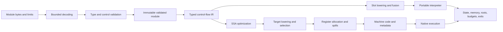

# Core Compiler and Execution Design

Date: **2026-10-26**. Status: **implementation contract; see the validation record for implemented increments**. This is the core mechanism supplement to the [architecture](architecture.md), [native ABI](native-abi.md), and [performance contract](performance-contract.md).

## Complete profiles and common pipeline

The first acceptance profile is the complete **Core 2.0 binary execution and embedding contract**, using `WebAssembly/spec` commit `fffc6e12fa454e475455a7b58d3b5dc343980c10` (`wg-2.0`), including `test/core` and `test/core/simd`. It includes all scalar instructions and conversions, structured control flow, calls and indirect calls, globals, memories, multiple tables, reference types, multi-value/block parameters, sign extension, nontrapping conversions, bulk memory/table operations, passive/declarative segments, and fixed SIMD. Text parsing uses pinned development tooling; a native WAT parser and the JavaScript API are not VM requirements.

Later profiles add the full pinned Core 3.0 binary scope, including recursive types/WasmGC, typed function references, tail calls, final EH, extended constants, Memory64/**Table64**, multi-memory, and relaxed SIMD. Core Threads remains a separate profile switch. Every enabled feature must be implemented in the selected backend before compilation succeeds. A declaration, decoded opcode, or interpreter-only implementation does not establish native support.

`Compile` validates and prepares the requested backend. Interpreter compilation means decoding/validation and bytecode lowering; native compilation means generating **host CPU machine code from guest Wasm**. Building the VM with Go or LLGo is a separate compilation step. No external LLVM optimizer or Rust/C++ Wasm compiler is required for the planned native path.

## Frontend and validated module

Bound module bytes, section/vector sizes, function bodies, locals, nesting, and all intermediate allocations before allocating. Check LEB widths, integer overflow, UTF-8 names, section ordering/uniqueness, index spaces, function/code agreement, and instruction/immediate boundaries. Retain source offsets for diagnostics. Malformed encoding, invalid typing, disabled/unsupported feature, and resource exhaustion have distinct errors. Declared maxima never override host quotas.

The validator implements operand and control stacks, stack polymorphism in unreachable code, block inputs/results, branch arity, mutability, import/export types, constant expressions, segment rules, and feature dependencies. Parsing does not grant permission to execute. Only validator-produced immutable modules can enter lowering or instantiation. Reference types and signatures are canonical identifiers, with Store ownership checked separately at runtime.

Instantiation resolves every import, checks Engine/Store/type domains and limits, allocates state, validates initializer/data/element ranges, and executes the start function with the ordinary execution budget. Failure releases allocations and references created by the attempt. Side effects already performed on imported memory, tables, or by host functions follow the specification and are **not** transactionally rolled back. Preserve declaration and initialization order; do not run a start function during compilation or benchmark setup while claiming it is excluded.

## Typed control-flow IR

Use basic blocks with typed parameters, explicit branch edges and argument lists, and values identified by dense indexes. Lower the validated operand stack into SSA value identities; retain mutable locals through explicit local operations initially, then promote eligible locals through a verified pass. Block parameters express merges; branches and parallel copies must handle cyclic moves. A verifier checks dominance, types, block arity, terminators, source locations, and definitions after each transforming pass in tests/debug builds.

Each operation records effects: reads/writes to a particular state domain, potential trap, host call, allocation, suspension, and original Wasm fuel charge. Memory operations identify the memory and address width; table operations identify the table and index width. Calls distinguish direct, indirect, host, and later tail calls. Keep numeric values and reference handles typed throughout lowering; never erase references into anonymous scalar spill slots.

Do not fold a trapping expression into a compile-time module rejection when the specification traps only upon execution. Dead-code removal, common-subexpression elimination, constant folding, bounds-check elimination, and inlining must preserve observable effects, trap order, permitted floating-point outcomes, and resource policy. No unsafe fast-math. Preserve source maps from generated instructions to guest operations for traps, traces and metering.

Resource policy is part of compilation configuration and the cache key. With deterministic fuel enabled, charge original Wasm instructions at their semantic boundaries, before their effects. Fused instructions retain sub-operation costs and exits. Coarse prepaid blocks are allowed only where identical exhaustion/side-effect behavior is proved; otherwise retain finer checks or use a separately named budget mode. Optimizing away a loop must not erase its configured fuel exhaustion behavior. Cancellation polling is a separate bounded-latency contract.

### Implemented IR contract

`internal/compiler/lower` lowers every statically valid Core 2.0 function to
`internal/compiler/ir`. Instruction schemas come from the validator's typed
walk; there is no duplicated opcode typing table. Sources retain byte offsets,
immediates, effects and input/output types. Mutable locals remain explicit.
Control edges carry ordered tuples, and unreachable blocks/values are removed
without executing or folding trapping operations.

The verifier checks single definitions, dominance, use order, function/local
types, operand and edge types, terminators, reachability and effect metadata.
It uses iterative traversal and bounded dominance work. Node and verification
budgets apply across the whole module; zero is a literal zero budget. Source
schemas are internal trusted compiler data, not a serialized input format.

Fuel model version 1 charges one unit before each executed Wasm instruction,
except `else` and `end` delimiters. Compiler-generated transfers have no extra
charge. A loop header is charged on entry from outside; a backedge charges its
branch and the subsequent body instructions. These costs are retained in IR;
runtime metering and cancellation are subsequent implementation work.

## Interpreter lowering and hot loop

Lower SSA values and locals into reusable typed slots with precomputed frame sizes. Resolve branches, function indexes, local offsets, immediates, memory offsets and stack effects at compile time. Keep immutable instruction arrays compact and contiguous. A separate read-only pool holds uncommon wide immediates/branch tables. Dispatch uses a Go `switch`; ordinary Go has no portable computed-goto contract. Do not implement dispatch through per-op closures, reflection, or `interface{}` values.

The execution hot loop uses a program counter, explicit frame base and slot arrays. Operand reads are guarded direct slot loads; backend/metering selection is fixed for each Run invocation. Immutable source/instruction metadata is borrowed so scalar dispatch does not copy wide SIMD immediates. Scalar slots hold exact bit patterns; reference slots hold checked handles with type/root metadata. Frame allocation, locals, outgoing arguments, results, and spill areas use pre-sized storage, growing only at explicit checked boundaries. Guest calls push explicit frames rather than recursively calling Go. Return and `br_table` copy overlapping tuples correctly. Preserve suspended frame state across host calls and resume.

The active PC and bounded frame-value view now stay local to that loop. Publish
the caller's next PC before guest push or host suspension, and refresh both
views at every frame transition or Run entry. Arguments copied after push read
the preserved global arena, since growth can invalidate the former view.
Nontrapping integer instructions call shared small numeric primitives directly,
avoiding the generic evaluator's second opcode dispatch. Typed-bit instantiation
exposes the same canonical implementations to LLGo's package optimizer; it is
not a separate semantic evaluator. Trapping and FP operations keep the generic
evaluator. Source/fuel/trap identities and all polls remain unchanged.

The LLGo release profile uses `-O3 -lto=full` for engine/CLI builds, the native
probe and semantic CI. Source comparisons apply identical flags to base/head.
Default `-Os` diagnostics retain observed regressions; an inlined helper or a
release-profile improvement does not establish a default-build performance win.

Start with a simple verified lowering. Measure register/slot dispatch against a predecoded stack-dispatch prototype using identical complete semantics. The default design is slot bytecode; change it only with measured evidence covering both compilers, dispatch cost, bytecode size, compile latency, and representative workloads. Do not maintain two permanent production interpreters merely to preserve the experiment.

Optimize demonstrated bottlenecks with direct local/constant forms, copy elimination, block layout, and bounded superinstructions. Fusion must preserve fuel, trap locations, memory effects and safepoints. Pre-resolve internal direct calls; indirect calls retain null, bounds, signature, ownership, and instance checks. Poll at calls, backedges and a maximum straight-line work interval; chunk bulk operations. An unmetered mode still observes cancellation and resource limits. There is no unchecked performance mode for untrusted guests.

Keep allocation out of warmed numeric execution after frames/results are reserved. API allocations, growth and host callbacks are measured separately. Private linear memory can use inlined checked access after profiling; shared memory must retain the common synchronization contract. Check address-plus-offset overflow before bounds and host-index conversion. Preserve the specified failure result for expected grow failures.

### Implemented slot lowering

`internal/compiler/slots` emits flat 32-byte instructions, inline ordinary
operands/results, and separate pools for call/return arguments, edges and moves.
Every emitted instruction retains its Wasm source/fuel identity. Blocks have
resolved instruction offsets. Function locals occupy the frame prefix; scalar,
vector and reference slots keep distinct types for future root scanning.

The initial allocator recycles block-local temporaries by type and last use.
Cross-block values and block parameters have dedicated slots. This conservative
policy bounds compilation without constructing a global interference graph;
whole-function allocation is a later measured optimization. Results do not
clobber input slots at an instruction or suspended-call boundary. Parallel
edge copies use a linear expected-time resolver and typed scratch for cycles.
Per-function frame slots and aggregate lowering/verification work are bounded.

An unconditional forward edge to an empty return block can return its incoming
tuple directly. This keeps every original instruction PC and the predecessor's
source/fuel charge while removing the intermediate tuple copy and dispatch.
Backward edges retain their cancellation poll. Conditional, effectful and
reordered/subset return blocks keep their original transfer plan. Native leaf
analysis stops at the reached return, preserving call expansion when a former
return block remains independently addressable afterwards.

Symbolic tests independently simulate slot reads, writes and edge transfers for
every valid corpus function. This establishes lowering preservation, not
instruction execution, runtime rooting or interpreter performance. The complete
Core 2.0 execution corpus and current performance limits are recorded separately
in the [validation record](../validation.md).

## Native compilation

The complete native pipeline is: typed IR verification, optimization, legalization to target operations, instruction selection, register allocation, spill insertion, frame layout, branch resolution/relocations, code emission, and publication with trap/safepoint/source maps. Implement amd64 and arm64 emitters in Go. The baseline uses linear-scan allocation with separate integer/vector classes, fixed-register constraints, call clobbers, live-range splitting, parallel-move resolution, and verified spill reloads. Target tests check actual execution as well as encoding/disassembly.

The current development allocator assigns stable homes by bounded CFG loop-use
priorities; global live-range splitting remains required work. Merged backward
edge intervals provide capped frequency hints, including nested/overlapping
spans. They do not prove reachability or justify removing a check. Tuple/move
and expanded-leaf literal scans have separate work budgets and conservative
priority fallbacks. Candidate ordering is deterministic by score, class and key.
AArch64 integer/reference homes compete with immutable literal/runtime words
before the inventory fills: homes prefer x19-x28, while all classes can use
x1-x8. FP/vector homes retain their separate shared pool. Immutable words reload
on every entry, including missing-view zeros for checked indirect fallback. Leaf
expansion excludes them through the same target inventory. Every mutable
allocation reloads at entry and spills on all exits; reserved ABI registers and
the separate FP/vector bank remain excluded. Scalar `select`
now uses CMOV/CSEL and directly names allocated integer/reference registers,
falling back to scratch loads for spilled or FP bit patterns. It tests only low
i32 condition bits and preserves source/destination aliases. The precise tier
selects both input words; unmetered scalar storage follows its existing
canonical-input contract. V128 retains its complete vector transfer path.

Use the platform's accepted baseline CPU feature set, with explicit detection and recorded features for optional instructions. Specialized artifacts cannot run on a weaker CPU. Floating-point/vector operations require correct Wasm NaNs, signed zero, rounding, conversions and lane behavior. Division and conversion instructions often need explicit prechecks; host instruction traps and language overflow behavior are not automatically Wasm semantics.

Initially emit explicit memory/table/stack bounds checks and explicit trap exits. Signal-handler recovery is not the default safety mechanism. Eliminate checks only with validated range/effect proofs covering growth, calls, 64-bit overflow and aliases. Imported or mutable function/table targets cannot be treated as immutable without valid guards. Mark the entire profile supported only when each operation has verified native lowering or a documented runtime helper with the same semantics; helper use is reported in performance evidence. Native execution must never interpret an unsupported function silently.

The unmetered backend groups at least three affine accesses anchored in unchanged
i32 locals within its existing <=256-instruction, positive-minimum-memory
regions. Guards read the first access's existing address operand and validate
the entire span against memory32 and the current binding. Failed guards enter
the original checked instruction sequence at that access, preserving earlier
effects and the actual first trap. Interior cold PCs keep all checks. The precise
tier and unmatched addresses retain their existing lowering.

After proving no address addition wrapped, the emitter folds biases into memory
offsets. Bounded backwards liveness removes only dead i32 constant/add temporary
writes; guards and possible traps restore full physical-frame requirements.
Remapped accesses and removed instructions bound older fusion selectors. Fixed
register weights reflect the emitted reads/writes, including guard operands.
For arm64 spans up to 4096 bytes, let `u = uint32(address - firstBias)` and
`span = firstBias + after`. One unsigned interval check rejects both subtraction
underflow and an end past memory32. A widened end check against the bound memory
still admits an exact 4 GiB endpoint. Larger spans and amd64 keep the general
lowering; guard failure preserves the original operand and checked continuation.

Fusion stops at remapped accesses and deleted operations. Physical-state scans
may cross accesses already proved safe, but stop at every later guard, possible
trap, poll, CFG edge, helper and region end. These separate bounds allow dead
literal removal without granting a fusion selector an original, stale address.
AArch64 shift-plus-ADD/SUB/AND/OR/XOR selection uses the same observation scan;
it retains live constants, rejects observed intermediate values and preserves
aliases and all original cold PCs. Rotate forms apply only to logical operands.
Local versions invalidate stale facts; CFG/helper/growth/poll boundaries reset
analysis. All memory operations still execute in order.

A bounded loop analysis additionally recognizes one-block, literal-bounded i32
+1 recurrences whose accesses share one affine root. The update follows every
access, the root's base remains invariant, edges have no moves, and a pure
local/copy/constant/add prefix contains at most 16 operations. Calls, growth, possible arithmetic traps,
internal CFG entries, nonlinear addresses and unsupported recurrences retain
ordinary checked code. The entire candidate, including its branch, stays within
one 256-instruction interval.

The original header executes its canonical prefix, then checks `i < limit` and
`uint32(firstAddress - firstBias) + (limit - 1 - i) + span <= 2^32` and the bound
memory length, using widened arithmetic. A failed check resumes the exact first
checked access without replaying prefix effects or trapping early. A successful
check enters a shared body with a private prefix/backedge and no repeated span
check. Original dispatcher PCs and cold conditional branches always target
checked original headers. Private backedges keep interruption polls; any return
to the driver loses the proof. Warm-only dead temporary removal preserves all
physical slots at every exit. This is conservative loop versioning; global
live-range allocation and broader loop/range optimization remain required.

Use a private guest ABI with explicit VM frames: guest calls push checked logical frames and branch to native callee labels; returns branch to saved continuations. The initial backend keeps one bounded C entry frame, without hardware-stack switching or a native C/Go frame per guest call. Host interaction, collection, cancellation and traps leave through the explicit status protocol in the [native ABI](native-abi.md). Whole-function inlining and more advanced optimization follow correctness and profiling; both disabled and enabled optimizations must pass differential tests. A persistent AOT/cache file format is later work; generating native code in-process is required in M2.

## Direct numeric globals

Both emitters lower validated numeric global.get/set in precise and unmetered
entries. An execution-owned native view provides per-index cell pointers;
imported aliases share cells. Scalar precise copies preserve both words, while
unmetered scalar values retain the canonical zero high word. V128 accesses use
allocated vector operands and exact 128-bit loads/stores, including spilled
values. Allocated scalar integer/FP registers load/store directly, avoiding
integer/FP bit transfers. Unmetered scalar stores retain canonical zero words
without rewriting them. Spare arm64 caller registers cache immutable pointers, sharing the
existing allocator with table metadata. Mutable cell contents are always live.

The driver snapshots only referenced numeric globals before Run and publishes
writes after every native exit, before host/helper handling or errors. Reference
globals keep the existing helper/root path. Missing views fail before any guest
instruction and original cold continuations retain the same contract. See the
[scope](../../benchmarks/native/globals-plan.md) and [native ABI](native-abi.md).
This removes helper transitions; broader global live ranges remain open.

## Direct tables and function references

Both emitters lower table.get/table.set and ref.func in precise and unmetered
entries through the shared runtime view. Table length checks precede scaled
addressing and preserve exact source/trap order. Reads and writes use the same
native table cells as the Store's reference tracer, including imported aliases.
Function IDs come from the current instance's immutable handle array. No Go
pointer or machine function address is encoded as a guest reference. Spare
arm64 metadata registers share the existing allocation pool; all element values
remain live reads. Allocated reference registers access table cells directly;
arm64 uses an extended length comparison and UXTW addressing to consume i32
indices without changing their raw upper words. Precise and spilled paths share
the element encoder with guarded indirect calls. Reference slots retain the
conservative spill/root protocol.

Ordinary entries request their own runtime view independently of optional leaf
expansion. Host reentry, table growth and bulk helpers rebind on the next entry;
empty, Go-backed and retired storage retain distinct boundary outcomes. Bulk
operations and growth continue through explicit owned helpers. See the
[scope](../../benchmarks/native/tables-plan.md) and [native ABI](native-abi.md).
This removes the basic table/reference helper transitions, without accepting
general call, register-allocation or whole-profile performance.

## Implemented private memory primitives

`internal/engine/memory` enforces Core 2.0 page limits, independent host quotas,
widened effective-address arithmetic and host-index bounds. It implements all
scalar and fixed-SIMD loads/stores, growth, host copies and bulk copy/fill/init.
Every rejected range is detected before mutation. Overlapping copies preserve
snapshot semantics. Lane loads preserve other lanes; zero loads clear the
remaining lanes. Shared-memory synchronization is outside this Core 2.0 package.

Buffers have exact requested capacity. Growth preserves existing bytes and
zeroes the new pages; quota failure leaves memory unchanged. The old and new
buffers may coexist transiently during copying and until host collection, so
the page quota bounds logical memory rather than process RSS. Store-wide memory
accounting and scheduling of chunked bulk operations remain runtime work.

## Implemented Core 2.0 execution

`internal/engine/state` owns typed imports, canonical signature identities,
Store-local function references, globals, tables, memories and segment state.
Allocation resolves every import before side effects and rolls back its new
state on failure. Initialization follows active elements, declarative drops,
active data and a separately driven start call. Earlier imported-state effects
survive later traps; escaped functions retain their originating instance.

`internal/engine/execute` executes flat slot code with explicit bounded guest
frames. Host calls return requests to a driver, which may run a nested
continuation and then resume the suspended caller. Frame and pending-host
reference slots have root visitors. All opcodes use the owned numeric, SIMD,
memory and table semantics. No competitor runtime is invoked.

Fuel model v1 charges before effects. Cancellation is checked at entry, calls,
backedges, at most every 64 straight-line instructions, and between 4-KiB memory
or 512-element table chunks. Bounds traps precheck entire bulk ranges;
cancellation may leave partial progress. The execution object can be reused;
a warmed scalar call has zero allocations in the Go allocation-counter test.

These internal mechanisms pass the complete binary corpus on both supported
platforms under Go and LLGo. The [public driver](../embedding.md) now supplies
single-executor admission, callback reentry, shared fuel/frame quotas, opaque
host roots, safepoint collection, cancellation and deferred close. Active and
suspended frames preserve instance ownership. Imported effects and escaped
functions survive failed instantiation; unreachable failed cycles are reclaimed.
Canonical types retain a bounded Store-lifetime cache, while function identity
holes and empty memory/table objects have explicit quotas. Public call costs
are separate from the internal dispatch allocation test and remain to be
measured by the own-engine benchmark integration.

## Runtime, lifecycle and observability

Both backends use the same Engine/Store/Instance ownership model, memory/table/heap domains, host signature checks and typed outcomes. Compiled artifacts are immutable and reference counted or otherwise retained until all instances and active/suspended executions release them. Closing an Engine prevents new work and cannot unmap code used by a continuation. Store `Close` is an idempotent, nonblocking close request: prevent new work, signal cancellation and resolve waits once, then reclaim after active callbacks/executions leave. It is safe from a host callback and never joins itself. A separate `WaitClosed(ctx)` is for an external caller to await reclamation with a deadline; calling it from an active callback of that Store is outside its contract. Host-boundary deferred cleanup releases reentry tokens, temporary roots and execution/code leases before propagating a host panic, allowing the caller to recover without leaving a busy Store. An arbitrary blocking user callback remains outside any promised preemption bound.

Define explicit exits for return, host request, trap, budget exhaustion, cancellation, allocation/growth, and suspension; later add exception and async state without using Go panic as guest control flow. Root maps cover active and suspended frames, locals, temporaries, host handles and exception payloads. Every collection/reentry boundary spills live guest references before allocation or entering the host. Keep Go objects rooted in Go-managed tables; machine registers and native stacks contain handles rather than sole copies of host pointers.

Debugging must retain module/function/byte-offset and guest stack information without depending on native PC readability after code is freed. Benchmark phase timers wrap actual API or internal phase intervals; phases that overlap through lazy compilation/tiering are reported as such. The first backend is eagerly compiled with tiering disabled, so first-call and warmed-call costs have clear meaning.

## Tests and completion evidence

| Layer | Required checks |
| --- | --- |
| Decode/validate | Complete pinned profile tests including malformed/invalid/unlinkable inputs; truncation/LEB/allocation fuzzing; no panics for hostile bytes |
| IR/optimization | Verifiers; branch/tuple/loop cases; differential optimized/unoptimized execution; fuel, trap and side-effect order; legal NaN outcome sets |
| Interpreter | Every opcode and trap; explicit frame/stack limits; host reentry, growth and cancellation; full Core 2.0 corpus |
| Native | Same corpus on both CPUs/host compilers; spills, long branches, large frames, register clobbers, SIMD and indirect calls; ABI/lifecycle stress |
| Runtime | Import identity, aliasing, partial instantiation failures, start traps, repeated close, close from a callback, host panic/recover cleanup, suspend/resume, memory quotas and stale/foreign handles |
| Performance | Own base/head and competitors; isolated subsystem workloads plus representative applications; raw results and compiler/platform metadata |

Run semantic tests with Go and LLGo, and retain Go race/fuzz diagnostics separately. Target at least **90% statement coverage per owned executable core package**, with uncovered paths explained; assembly/machine-code correctness requires target execution tests rather than that percentage. Coverage and passing differential samples cannot substitute for a complete conformance manifest. Missing tests or unsupported operations block profile acceptance. [The roadmap](../roadmap.md) closes a milestone only after all its correctness, compiler, lifecycle, and performance gates pass.

## Individually enabled constant expressions

`EngineConfig.Features` is an explicit additive `wasm.Features` mask over the
complete default `core2` profile. `wasm.ExtendedConst` enables the six i32/i64
add/sub/mul instructions in constant expressions. Unknown feature bits fail
with `ErrUnsupported`; enabling this flag does not select full Core 3.0.
`Inspect` and compiled metadata report the enabled mask; the CLI accepts
`--extended-const` for validate, inspect and run.

Validation uses a typed operand stack, permits only imported immutable globals,
requires exactly one result of the destination type and applies `MaxStack` to
initializer depth as well as function bodies. Decode node limits bound total
initializer work. Validation records the maximum initializer depth. Allocation
and active-segment initialization each reuse one bounded scratch stack, with
small expressions on local storage. Evaluation uses unsigned wrapping integer
arithmetic, preserves subtraction order and resolves imports per instance.
Both backends share this path, including segment trap ordering and cleanup;
initializers never execute a guest function or consume function fuel.

The full archived feature proposal corpus is pinned in
[testdata/extended-const](../../testdata/extended-const/README.md), alongside
explicit default-profile rejection, resource, wrapping, cross-instance and
public API tests. Core 3.0 profile acceptance remains separate.
