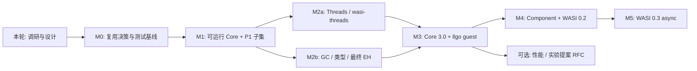

# 实施路线与验收

2026-10-26 初始版本。本仓库当前只完成调研、设计、包职责声明和宿主编译器探针，所有 VM 功能仍待实现。阶段按依赖和退出条件排序，不把未估量的复杂度转换成承诺工期。

## 先做复用决策

Wago 已覆盖大量相同目标，wazero 有成熟嵌入生态及实验特性；应先用实测决定投入方向。M0 必须保留候选引擎 commit、许可证、测试日志、编译器版本和 patch，最终产出 `docs/design/reuse-decision.md`（尚未创建），明确选择以下之一：直接复用并贡献上游、维护有限兼容层，或独立实现。

| M0 实验 | 需要回答的问题 | 判定证据 |
| --- | --- | --- |
| Wago 用 Go/llgo 编译和测试 | native trampoline、ABIInternal/汇编/unsafe 能否隔离；是否已有纯解释执行路径 | 两编译器日志、失败最小复现、实际改动范围 |
| wazero 解释器用 llgo 构建 | runtime/reflect/ABI/汇编依赖是否能隔离；实验 GC/EH/threads 组合是否可用 | 固定 main/release/PR commit，禁止把未合并 PR 记为 release 功能 |
| 固定 GC/线程/EH/WASI fixture | 候选实现声明与真实覆盖是否一致 | spec assertion、unsupported/skip 清单、差分结果 |
| llgo guest 集成 spike | shared `env.memory`、spawn、TLS、EH、SIMD、linear-memory GC 的真实缺口 | 最小 pthread/Go goroutine/GC/panic 程序与 imports/features 清单 |
| 维护和许可评估 | 上游是否接受 llgo 支持；是否能以较小补丁持续升级 | issue/PR 如需提交另按任务授权；许可证及 notice 清单 |

本轮不执行全量候选引擎移植或复制第三方代码。已有源码证据足以把“Wago 需要实际 llgo 适配评估”列为优先事项，尚不足以宣称它不可移植。

## 阶段依赖

M2a、M2b 可在共享值布局和验证器接口稳定后并行。llgo guest 的最终通过依赖两条线和 SIMD，不能仅在 M2a 完成线程后就宣称兼容 llgo guest。调研文档的 S 系列是按标准能力细分的建议，本表 M 系列是本仓库的实施与验收主计划。

## 阶段退出标准

| 阶段 | 范围 | 必须满足的退出标准 |
| --- | --- | --- |
| 本轮设计 | 文档、公开包占位、共同宿主探针、CI | 来源可查，目标/现状分开；双编译器实际执行测试，记录本地/远端结果 |
| M0 | 复用结论、fixture manifest、CI 扩展 | 有证据比较 Wago/wazero/自研；锁定 spec/WIT/tools commits；两个编译器执行相同基础 corpus |
| M1 | decoder/validator、MVP/常用 Core 2.0、解释器、P1 CLI 子集 | official positive/negative cases；最小 Go wasip1 程序；分开报告 trap/exit/timeout；fuel/stack/memory 限额生效 |
| M2a | 完整目标 P1 接口、Core Threads、legacy wasi-threads | atomics/wait-notify/grow litmus；pthread/TLS/栈隔离；trap/exit 全线程终止；Go race；两个编译器均运行 |
| M2b | recursive types/subtyping、GC、typed refs、tail calls、最终 EH | spec 对应目录；每次分配触发收集仍正确；root/externref/异常/host callback 生命周期；尾递归不增长宿主栈 |
| M3 | SIMD/relaxed SIMD、memory64、多内存、extended const、Core 3.0 缺口 | 完整目标 feature suite 与限制清单；llgo guest 的线程+GC+panic+I/O 集成；正式列出 host OS/arch 支持 |
| M4 | 组件二进制/类型/Canonical ABI/resources、WASI 0.2 | 固定 0.2.12 WIT；跨语言 CLI 组合；borrow/drop/post-return/编码与错误路径；逐项公布 filesystem/sockets/HTTP 覆盖 |
| M5 | WASI 0.3、future/stream/native async | 固定 0.3.2 WIT 与累计 Component 特性（包括 0.3.1 采用项）；取消、背压、reentrancy、resource 泄漏；CLI 与 HTTP worlds |
| 可选扩展 | stack switching、shared-everything、legacy EH、WASIX、JIT | 每项单独 RFC、feature gate、规范快照和测试报告；不影响默认路径双编译器可用 |

“完整目标 P1 接口”不意味着在缺少对应宿主能力的平台上模拟一切行为；必须按规范返回能力不足/不支持的结果，并将平台边界列入报告。WASI 0.2/0.3 阶段按 world 和 interface 分批验收，未覆盖全部范围时明确标注子集。

## 测试与性能基线

测试矩阵是 `host compiler × OS/arch × core profile × WASI/WIT version × guest producer`。核心语义在 Go/llgo 两条路径运行同一 fixture。Go race/fuzz 是额外检测，不能替代 llgo 路径执行。最小 fixture 优先提交并记录生成命令；较大官方 corpus 固定 SHA 和许可证，下载失败是基础设施失败，不能转为静默 skip。

每个里程碑增加负例：非法模块、禁用 feature、错误 import/type、超额内存/线程/heap、关闭后的 handle、跨 Store ref、重复 drop、取消与退出。测试报告分别计通过/失败/unsupported/skip，禁止只展示过滤后的通过率。

性能先测后定目标：模块验证与实例化延迟、稳态解释吞吐、每实例常驻内存、GC pause/分配吞吐、线程数对应的宿主栈开销、wait/notify 延迟和共享内存锁竞争。与 Wago 原生后端、wazero 解释器和 Wasmtime 做对照，明确注明执行后端，并分别列冷/热路径、host compiler、机器、flags；不提前承诺接近 JIT 性能。

## 主要风险与应对

| 风险 | 影响 | 验证或应对 |
| --- | --- | --- |
| 重复实现已有纯 Go 引擎 | 长期维护成本远高于预期 | M0 先实测复用，再定内核来源 |
| Go/llgo 私有 ABI 差异 | 代码能在 Go 编译但 llgo 崩溃 | 禁止核心私有 runtime/汇编桥；从第一批测试双跑 |
| WasmGC 类型和 roots 错误 | 错误接受模块、悬空引用或泄漏 | 官方类型测试、强制 GC、generation handles |
| Wasm 与 Go 内存模型不同 | race、非原子访问不安全、丢唤醒 | 同步内存参考后端、litmus、race、退出压力测试 |
| LLGo goroutine 的原生线程/栈成本 | 大量 guest 线程耗尽宿主资源 | 硬配额、显式 guest frames、线程规模基准 |
| Component ABI 与 P3 实现量大 | “支持 WASI”范围不断膨胀 | 分版本/world/接口，锁定 WIT，M4/M5 分开 |
| Capability filesystem 不完整 | guest 逃逸授权目录 | dir handle 设计，symlink/TOCTOU 负例，逐平台验收 |
| 工具链/提案变化 | CI 和兼容性漂移 | 固定版本，更新时生成差异与完整验证报告 |

本阶段没有承诺时间表、性能指标或完整安全审计结论。进入实现时以每个里程碑的实测工作量和维护资源再排期。
