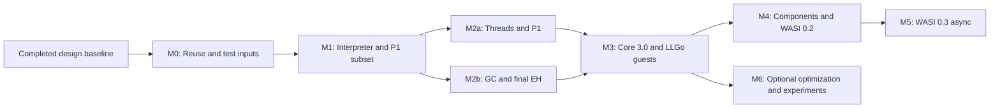

# Development Plan and Acceptance Gates

Plan date: **2026-10-26**. Research, architecture, package declarations, host compatibility probes, and the initial Go/LLGo CI matrix are complete. **All VM implementation milestones below remain planned.** This document is the authoritative implementation sequence; the acceptance summary in the standards report maps its technical scope onto these milestones.

The plan uses dependencies and measurable exit conditions rather than unvalidated delivery dates. Estimate calendar time after M0 establishes the reuse boundary and M1 provides actual implementation throughput. The existing research is a dated snapshot; translation and planning updates do not constitute a new survey or new runtime validation.

## Milestone overview

| Phase | User-visible outcome | Prerequisite | Primary implementation areas | Exit evidence |
| --- | --- | --- | --- | --- |
| M0 | A justified implementation choice and reproducible test inputs | Completed design baseline | Candidate experiments, fixture manifest, test tooling | Reuse decision, compiler results, patch estimates, license inventory |
| M1 | Run small core modules and a defined P1 CLI subset through an embedding API and CLI | M0 | Core decode/validate, interpreter, memory, VM API, P1 host | Pinned positive/negative tests and minimal Go wasip1 guest on both host compilers |
| M2a | Run shared-memory workloads and legacy wasi-threads guests | M1 | Memory synchronization, waiters, scheduler, P1 resources, thread ABI | Atomic litmus tests, pthread/TLS fixtures, exit/cancellation tests, Go race checks |
| M2b | Run GC-enabled modules with typed references and final exception handling | M1 | Type canonicalization, guest heap, roots, reference instructions, EH | Official feature suites, forced collection, host-root lifetime and tail-call tests |
| M3 | Complete the declared Core 3.0 binary profile and run LLGo-produced guests | M2a + M2b | SIMD, Memory64, multi-memory, remaining Core features, guest integration | Full declared profile results and LLGo threads/GC/panic/I/O integration on both compilers |
| M4 | Run composed WASI 0.2 applications | M3 for milestone acceptance | Component decode/validate/link, Canonical ABI, resources, P2 host | Versioned WIT/world coverage, cross-language composition, ownership and ABI tests |
| M5 | Run WASI 0.3 async components | M4 | Component async, futures/streams, P3 host | Async ABI, cancellation/backpressure, lifecycle, CLI and HTTP world results |
| M6 | Improve measured bottlenecks or add selected experimental features | M3; feature-specific dependencies may require M4/M5 | Optional backend/platform work and separate proposal implementations | Per-feature RFC, benchmark or conformance evidence, preserved default-path portability |

M4 research and ABI prototypes may start earlier, but they must not displace the M1–M3 correctness work or be reported as an accepted runtime milestone. Core Threads and WasmGC are required work in M2, not optional M6 features.

## M0 — Reuse decision and reproducible inputs

**Objective:** decide how much engine code to reuse before committing to a full independent implementation. The [implementation survey](research/implementations.md) identifies wazero and Wago as candidates, with different compatibility risks.

| Work package | Work | Deliverable |
| --- | --- | --- |
| M0.1 — Candidate baseline | Pin Wago, wazero, and comparison-engine revisions. Separate released, main-branch, and unmerged-PR features. Inventory licenses and notices. | Candidate manifest and reproducible commands |
| M0.2 — Dual-compiler experiments | Build and attempt to execute the same small API/host-call/P1 examples with Go and LLGo. Evaluate wazero's interpreter first; inspect Wago's native trampoline, ABI, stack, and collector requirements. | Build/run logs, minimal failure cases, and patch-scope estimates |
| M0.3 — Feature fixtures | Prepare GC, threads/wait-notify, EH, and shared-memory growth fixtures. Record unsupported combinations rather than treating them as passes. | Small versioned corpus with source, producer, expected result, profile, and license |
| M0.4 — LLGo guest inventory | Produce minimal LLGo guests for threads, GC, panic/recover, and I/O. Inspect imports, shared memory, TLS, EH, SIMD, and entry-point requirements. | Guest ABI/feature manifest and reference-engine results |
| M0.5 — Decision | Compare a reusable engine with a small compatibility layer, selective code reuse, and an independent interpreter. Consider upkeep, upstream fit, ABI risk, and public/internal package boundaries. | `docs/design/reuse-decision.md` and any architecture amendments |

The decision document and manifests above are planned artifacts, not existing files. M0 is a bounded experiment, not a full engine port. An unsuccessful LLGo candidate run is useful evidence; M0 does not require fixing every candidate before making a choice. Existing project probes must remain green, and any candidate failure must retain its exact command, revision, and reason.

**Exit gate:** the decision names the chosen implementation source, reusable assets, rejected alternatives with evidence, outstanding risks, and the impact on `pkg`/`internal` boundaries. Pin the initial Core/proposal/WIT inputs and generation tools. No third-party code is imported without checking its applicable licenses. If the chosen approach changes the portable-interpreter baseline, update the architecture explicitly before M1.

## M1 — Executable core and a P1 CLI subset

**Objective:** deliver the first end-to-end path from untrusted module bytes to a controlled execution result.

1. **M1.1: Core representation and decoder.** Define explicit feature sets, limits, value/reference representations, module IR, checked addresses, and typed errors. Implement bounded readers, LEB128, sections, indexes, and data/code size limits.
2. **M1.2: Validation.** Implement control/operand stacks, function and block signatures, unreachable code rules, import/export checks, and feature dependencies. Reject malformed and unsupported inputs before execution.
3. **M1.3: Interpreter and state.** Implement Engine, Store, CompiledModule, Instance, explicit guest frames, calls, tables/globals, private memory, basic host imports, traps, and deterministic cleanup. Check fuel, stack, allocation, and cancellation limits.
4. **M1.4: Usable vertical slice.** Add embedding examples and `cmd/wasmvm` with `validate`, `inspect`, and `run`. Implement the explicit P1 subset needed by a minimal official-Go wasip1 guest, including argument/environment access, stdio, and exit behavior as required by its imports.
5. **M1.5: Conformance harness.** Execute the pinned MVP/common Core 2.0 scope under both host compilers, including negative cases and a shared assertion format. Publish the exact supported feature list rather than claiming all Core 2.0 prematurely.

**Deliverables:** working CLI and embedding example, first documented public API, feature/limit report, reproducible P1 guest, and a common semantic test runner. Start the planned `internal/core`, `internal/engine`, `internal/spectest`, `tests`, and `testdata` packages only as needed.

**Exit gate:** both host compilers execute the same fixture corpus; malformed, invalid, unsupported, link, trap, WASI exit, resource-limit, and cancellation results are distinguishable. The minimal P1 program runs correctly. Excessive memory, stack, and execution requests fail within configured bounds. Remaining unsupported features are explicitly rejected.

## M2a — Shared memory, threads, and P1 completion

**Objective:** implement the declared P1 interface scope and shared-linear-memory threading without introducing Go data races.

1. **M2a.1: Shared memory.** Route ordinary and atomic accesses, bulk operations, size/grow, and host memory access through the synchronization domain. Implement alignment/bounds rules, mixed-width operations, atomics, and fence ordering.
2. **M2a.2: Waiters and lifecycle.** Implement atomic wait registration, notify counts, timeout outcomes, and one-time completion arbitration for notify/cancel/close races. Enforce thread/resource limits and bounded teardown.
3. **M2a.3: Legacy wasi-threads.** Implement `wasi.thread-spawn` and `wasi_thread_start`, per-thread instances/stacks/TLS, shared process resources, child initialization, and rollback on failed creation.
4. **M2a.4: P1 host coverage.** Complete the declared P1 APIs, including capability-based filesystem access, fd rights/lifecycle, clocks/random, polling, and specified error behavior. Document host-platform limitations rather than silently emulating unavailable capabilities.

**Deliverables:** separate `pkg/wasi/threads` adapter, P1 operation coverage table, pthread/TLS fixtures, atomic litmus tests, and concurrent lifecycle stress tests.

**Exit gate:** demonstrate no lost wakeups, correct timeout/not-equal/success results, safe growth during concurrent access, and correct thread-group exit/trap behavior. Validate active data/start/TLS initialization with pinned guest producers. Run all shared tests with Go and LLGo, with Go race checks as an additional diagnostic. Core Threads does not imply shared WasmGC objects or component threading.

## M2b — WasmGC, typed references, tail calls, and final EH

**Objective:** implement guest reference semantics independently of the host collector and of a guest language's linear-memory GC.

1. **M2b.1: Types.** Implement recursive type-group equivalence/canonicalization, explicit subtyping, nullability, variance, typed function references, casts, and cross-module matching.
2. **M2b.2: Heap and roots.** Implement the chosen Store-owned guest heap, object identity, generation-checked handles, heap quotas, tracing, and reclamation. Cover stack/local/global/table roots, exceptions, host handles, suspended contexts, and temporary references at allocating instructions.
3. **M2b.3: Reference instructions.** Implement struct/array operations, packed fields, i31, externref/anyref conversion, reference equality, and host rooting/release contracts.
4. **M2b.4: Control flow.** Implement proper tail calls and final EH (`try_table`, `exnref`, `throw_ref`), including tag identity, unwinding, host-call boundaries, and reference retention during exceptional paths.

**Deliverables:** type-system tests, official GC/reference/EH fixture coverage, forced-GC stress mode, and explicit host reference-lifetime examples.

**Exit gate:** the relevant official suites pass on both compilers. Collection at every supported allocation point preserves all live guest references, including values popped into temporary root scopes. Cycles, stale handles, foreign-Store references, quotas, host reentry, cancellation, and close are tested. Deep tail recursion does not grow the host stack. Legacy EH is not silently accepted as final EH.

## M3 — Core 3.0 profile and LLGo guest integration

**Objective:** combine M2a and M2b, close the remaining binary-Core feature gaps, and validate the guest toolchain that motivated the project.

- Implement fixed/relaxed SIMD, Memory64, multiple memories, extended constants, and any remaining items in the pinned Core 3.0 binary profile. Keep text-format tooling and JS embedding features separate from the VM's binary execution claim.
- Test feature combinations rather than only isolated instructions: GC with EH/host calls, threads with growth/cancellation, and independently owned GC heaps executing in parallel.
- Run pinned LLGo guests covering goroutines/pthreads, TLS, guest linear-memory GC, panic/recover, SIMD, and I/O. Preserve producer version, flags, imports, and expected results.
- Expand the compiler/platform matrix from Linux amd64 and macOS arm64 toward Linux arm64 as runners become available. Record the actual accepted matrix; leave Windows and 32-bit host support unclaimed until separately validated.
- Establish repeatable cold-start, throughput, memory, GC-pause, and thread-scale benchmarks. Address correctness and resource failures before adding optimized paths.

**Exit gate:** publish per-feature and per-platform conformance results for the full declared profile. Both host compilers pass the same LLGo guest integration tests. A profile claim requires all tests assigned to its supported scope to pass; unexplained exclusions prevent that claim. Resource/cancellation tests remain green under combined workloads.

## M4 — Component Model and WASI 0.2

**Objective:** support real component composition rather than only recognizing a component binary.

1. **M4.1: Component execution.** Implement binary decoding, validation, instance composition, imports/exports, and linking with explicit core-instance boundaries.
2. **M4.2: Canonical ABI.** Implement lift/lower, strings/lists/records/variants, realloc/post-return, and resource own/borrow/drop behavior with failure rollback.
3. **M4.3: P2 CLI.** Pin WASI **0.2.12** WIT and implement the declared `wasi:cli/command` world, including its clock/random/filesystem/I/O dependencies and pollable lifecycles.
4. **M4.4: Broader interfaces.** Add sockets and HTTP as separately reported interface groups, with explicit host capabilities and cross-language composition fixtures.

**Deliverables:** `pkg/component`, P2 bindings, a WIT/world/operation support manifest, component examples, and ABI/resource test suites.

**Exit gate:** components from at least two guest toolchains compose correctly under both host compilers. Validate encodings, ownership transfer, borrow restrictions, post-return, double-drop, errors, and resource cleanup. Distinguish supported CLI/HTTP/interface subsets; parsing or running one component is not a claim of complete WASI 0.2 support.

## M5 — WASI 0.3 native async

**Objective:** implement the published component async contract rather than mapping it loosely to goroutines or channels.

- Pin WASI **0.3.2** WIT and its cumulative Component Model requirements, including features adopted in 0.3.1.
- Design and implement canonical async lift/lower, task state transitions, suspension/resumption, futures, streams, cancellation, backpressure, reentrancy, and completion/error behavior.
- Implement P3 bindings by world, starting with CLI and then the applicable HTTP service/middleware scope. Keep P2 pollables and P3 native async as distinct versioned adapters.
- Add composition chains that exercise async host calls, nested component calls, cancellation propagation, stream closure, partial failure, and shutdown while tasks remain suspended.

**Deliverables:** an async ABI design supplement, `pkg/wasi/preview3`, versioned P3 coverage, and deterministic lifecycle/leak tests.

**Exit gate:** both compilers pass the same async ABI and declared-world fixtures, with no stranded tasks/resources after completion, cancellation, or close. Preserve tested P2 behavior. P3 acceptance does not require implementing every experimental stack-switching or component-threading proposal.

## M6 — Optional optimization and experimental proposals

Start only when earlier profiling or concrete compatibility needs justify the work. This phase may proceed alongside later component milestones if it does not compromise their correctness work.

Candidates include interpreter specialization, reduced shared-memory lock contention, improved GC strategy, additional platforms, JIT/AOT backends, stack switching, Shared-Everything Threads, legacy EH, or WASIX compatibility. Each is a separate decision and implementation effort, not a bundled promise.

**Exit gate for each item:** a scoped RFC, feature/backend flag, dependencies, benchmark or conformance evidence, and documented compatibility effects. The default portable path and common Go/LLGo semantic suite must keep passing. Experimental proposals use pinned snapshots and never silently alter a stable profile.

## Initial implementation backlog

The next work starts with M0, not with a new JIT or a full WASI component stack.

| Order | Task | Depends on | Completion artifact |
| --- | --- | --- | --- |
| 1 | Define the shared fixture/result manifest and select minimal core/P1/GC/thread/EH cases | Existing research | Reviewed schema and small reproducible fixtures |
| 2a | Run pinned wazero interpreter experiments with Go and LLGo | 1 | Logs, failure reproductions, and portability assessment |
| 2b | Run pinned Wago API/native-runtime experiments with Go and LLGo | 1; parallel with 2a | Logs, ABI/GC/stack findings, and adaptation assessment |
| 3 | Inventory LLGo guest imports/features and reference-engine behavior | 1; parallel with 2a/2b | Producer manifest and guest fixtures |
| 4 | Write the reuse decision and update the implementation/package boundary | 2a, 2b, 3 | Accepted M0 decision with license and maintenance analysis |
| 5 | Define foundational feature/value/error/limit contracts and a conformance-runner interface | 4 | Small public/internal API slice with shared tests |
| 6 | Deliver decode → validate → instantiate → call for a minimal core module | 5 | Working embedding example and negative fixtures |
| 7 | Add the minimal P1 guest and CLI execution path with cancellation/resource checks | 6 | End-to-end M1 vertical slice |

These are planned work items, not GitHub issues already created. Keep each implementation contribution independently reviewable. If one developer executes the plan, finish M1 and then sequence M2a/M2b as capacity allows; with parallel capacity, split those tracks after agreeing on their shared interfaces.

## Shared definition of done

Each implemented capability needs all of the following before being reported as supported:

- **Scope:** pinned specification/WIT/tool versions, exact feature/world/operation coverage, and explicit unsupported combinations.
- **Behavior:** positive and negative tests, lifecycle/rollback paths, limits, cancellation, and relevant feature interactions.
- **Compiler parity:** the same source, fixtures, and assertions execute with Go and LLGo. A compiler-wide skip or build-only result is not parity.
- **Evidence:** pass/fail/unsupported/skip counts with reasons, fixture provenance, producer flags, and reproducible commands. Missing corpus downloads are infrastructure failures, not silent skips.
- **API and documentation:** usable examples, ownership/concurrency contracts, diagnostics, current package boundaries, and an updated capability matrix.
- **Maintenance:** appropriate licenses/notices for imported assets and a bounded plan for any dependency fork or compatibility patch.

Use `host compiler × OS/arch × core profile × WASI/WIT version × guest producer` as the acceptance matrix. Go race and fuzz testing supplement semantic checks; they do not replace LLGo execution or prove the Wasm memory model. Cover malformed modules, disabled features, mismatched imports, excessive resources, stale/foreign handles, repeated drop/close, and cancellation/exit races at the applicable milestones.

## Performance and release readiness

Measure validation/instantiation latency, steady-state execution, per-instance memory, allocation throughput, GC pauses, host stack cost per guest thread, wait/notify latency, and shared-memory contention. Compare Wago's native backend, wazero's interpreter, and Wasmtime with their execution backends and configurations identified. Separate cold/warm paths and host compiler effects; do not promise JIT-like performance before measurement.

At each usable milestone, publish the supported matrix and reproducible examples. Before a release is described as production-ready, resolve known isolation/resource-lifecycle failures, document platform capability limits, establish API compatibility policy and a project license, and review the security-sensitive parser, validator, memory, and filesystem boundaries. A completed milestone is not itself a full security-audit claim. No release tags or publication dates are assigned by this plan.

## Risks and decision points

| Risk | Impact | Planned response |
| --- | --- | --- |
| Duplicating an existing Go engine | Excess implementation and maintenance cost | M0 compares reuse with independent implementation before committing |
| Go/LLGo private ABI differences | Builds pass but runtime behavior fails | Isolate any ABI-specific code; execute both compiler paths from the first slice |
| GC type/root mistakes | Invalid acceptance, dangling references, or retained objects | Official type suites, forced collection, temporary roots, checked handles |
| Wasm/Go memory-model mismatch | Host races or incorrect shared-memory semantics | Synchronized reference backend, litmus tests, race checks, cancellation stress |
| LLGo native thread/stack cost | Host exhaustion under large guest thread counts | Hard quotas, explicit guest frames, measured thread-scale limits |
| Component/P3 scope growth | Indefinite expansion of the WASI target | Separate versions, worlds, interfaces, and M4/M5 acceptance gates |
| Incomplete filesystem capabilities | Access outside authorized directories | Directory-handle design and per-platform symlink/TOCTOU negative tests |
| Toolchain and proposal drift | Regressions and ambiguous compatibility claims | Pinned inputs; explicit upgrade diffs and full affected-profile validation |

Revisit estimates and priorities at each exit gate using actual work completed, unresolved compatibility failures, and available engineering capacity. Preserve the required GC, threads, and dual-compiler goals when adjusting the implementation route.
