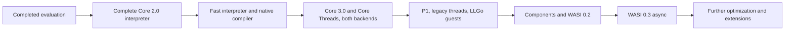

# Development Plan and Acceptance Gates

Plan date: **2026-10-26**. M0 candidate evaluation and benchmark infrastructure are complete through PRs [#1](https://github.com/cpunion/wasmvm/pull/1), [#2](https://github.com/cpunion/wasmvm/pull/2), and [#3](https://github.com/cpunion/wasmvm/pull/3). The owner has selected a [project-owned core](design/own-core.md). **M1 acceptance remains open; M2 executes the complete Core 2.0 profile but has unmet performance gates; M3–M7 are not implemented.** This plan prioritizes complete core execution and compilation before WASI integration. Design approval does not close an implementation or performance gate.

Implement stages in order. Independent work within a stage can proceed in parallel after agreeing on shared contracts. Small implementation PRs may merge while the stage remains in progress; every required deliverable, supported-platform result, and exit gate must pass before that stage is complete. Do not replace full profiles with convenient instruction subsets or quietly move failing requirements to a later stage.

## Stage overview

| Stage | Complete outcome | Required evidence |
| --- | --- | --- |
| M0 — Evaluation | Candidate/compiler/feature experiments, pinned inputs, comparison infrastructure | Completed bounded experiments; historical reuse decision superseded by the own-core decision |
| M1 — Complete portable core | Entire Core 2.0 binary frontend, interpreter, bounded VM lifecycle, embedding API and core CLI | Pinned complete Core 2.0 corpus, Go/LLGo execution, negative/resource/lifecycle tests, actual own-engine benchmarks |
| M2 — Fast core execution | Optimized interpreter and own amd64/arm64 native compiler for the **same entire Core 2.0 profile** | Full backend/compiler matrix, native ABI/lifetime tests, controlled performance gates |
| M3 — Modern core and threads | Full Core 3.0 plus separately enabled Core Threads on **both** backends | Official feature suites, GC/root/exception stress, memory-model tests, combined-workload performance |
| M4 — P1 and LLGo guests | Declared complete P1 host scope, legacy wasi-threads adapter and pinned Go/LLGo guest integration | WITX operation manifest, capability/ABI tests, pthread/TLS/exit/GC/panic/I/O tests |
| M5 — Components and P2 | Component execution, Canonical ABI and declared WASI 0.2.12 worlds/interfaces | Cross-language composition, resource ownership and ABI tests |
| M6 — P3 async | WASI 0.3.2 cumulative component async and declared worlds/interfaces | Futures/streams, cancellation/backpressure, reentry and deterministic cleanup tests |
| M7 — Further optimization and extensions | Separately selected advanced optimizations/platforms/proposals | Independent RFC, evidence and preserved earlier gates |

Earlier documents used M1 for a partial core/P1 slice, M2a for threads/P1, M2b for GC/EH, M3 for Core 3.0/LLGo guests, M4/M5 for P2/P3, and M6 for optional optimization. **This table replaces that schedule:** core threads/GC move into M3, P1/legacy threads/guests into M4, P2/P3 into M5/M6. Native compilation is now required in M2, not deferred. Historical evaluation records retain their original numbering.

## M0 — Completed evaluation, preserved evidence

Keep the [candidate evaluation](research/wazero-evaluation.md), [immutable input inventory](research/spec-inputs.md), LLGo guest manifest, licenses, upstream issue reproductions, and benchmark raw measurements. M0 did not pass a full engine conformance suite. Its successful compatibility fixes and unsupported-feature findings remain useful even after the implementation route changes. The new [decision](design/own-core.md) selects ownership; it does not invalidate measurements or establish future performance.

## M1 — Complete portable Core 2.0

**Objective:** accept untrusted module bytes and execute the complete Core 2.0 binary profile with bounded resource use through our own interpreter.

Current increments implement the bounded complete frontend, verified typed IR, reusable slots, all scalar/fixed-SIMD operations, private memory/tables, linking and staged initialization, plus an interpreter with explicit call frames and host-request exits. The complete [Core 2.0 input inventory](../testdata/core2/README.md) now passes locally under Go and LLGo: all 51,139 binary assertions across 148 scripts, with 1,091 text-parser assertions classified separately. Per-package coverage is at least 90%; CI retains actual execution counts and compiler identities.

The Store reclaims unescaped failed instances and releases storage after execution leases drain. The public embedding API now implements typed host imports, opaque reference roots, controlled reentry, shared budgets, cancellation and close, with runnable examples. The core CLI provides validate, inspect and typed run commands. M1 remains open for representative own-engine benchmarks and final acceptance. Passing the full binary corpus does not close these other gates; see the [validation record](validation.md).

1. **Contracts and corpus.** Define feature/backend/error/limit/value contracts, immutable module metadata, ownership, and the common fixture/result format. Import or deterministically generate the complete `test/core` and `test/core/simd` corpus at the pinned `wg-2.0` commit with licenses, file hashes and producer pins. Preserve assertion counts and classifications; missing tooling or fixtures are failures. Text syntax is handled by pinned development tools, not a required runtime WAT parser.
2. **Decode and validate.** Implement bounded readers and allocations, LEB128, sections, indexes, control and operand typing, unreachable semantics, imports/exports, block signatures, constant expressions, data/element rules and all profile instructions. Fuzz malformed/truncated inputs and resource claims; distinguish malformed, invalid, unsupported and resource errors.
3. **IR and interpreter.** Implement verified typed control-flow IR, slot lowering, explicit guest call frames, scalar/reference/vector values, all Core 2.0 instructions and traps. This includes fixed SIMD, multiple tables, multi-value, reference types, sign extension, nontrapping conversions, bulk operations and passive/declarative segments. No host-stack recursion for guest calls.
4. **VM and lifecycle.** Implement Engine/Store/CompiledModule/Linker/Instance/Execution, memory/tables/globals, host imports, start functions, reentry, quotas, deterministic fuel, bounded cancellation and close. Test instantiation failure cleanup without claiming rollback of externally visible imported-state effects. Keep the core independent of WASI.
5. **Usable interface and measurement.** Deliver working embedding/host-call examples and `cmd/wasmvm validate`, `inspect`, and core `run` with explicit typed arguments/results and backend reporting. Connect the existing phase protocol to a runner built from each exact wasmvm base/head checkout; keep wazero and competitors as separately identified rows. Record interpreter subsystem baselines and representative workloads before optimization.

**Exit gate:** the complete pinned Core 2.0 binary assertion set passes under Go and LLGo on Linux amd64 and macOS arm64; report script/assertion counts, no unexplained exclusions. Parser/validator/VM limits, trap classifications, reference ownership, host callbacks, cancellation and cleanup pass. Interpreter and compiler logic build with `CGO_ENABLED=0`. Report at least 90% statement coverage for each owned executable core package, plus named missing-path rationale; coverage is not conformance. Own-engine benchmark provenance is verified. No P1 or native execution claim is made at this stage.

## M2 — Fast interpreter and complete native compiler

**Objective:** make both interpretation and Wasm-to-native execution satisfy the [performance contract](design/performance-contract.md), without changing the accepted Core 2.0 semantics.

The development native backend now executes the same complete Core 2.0 corpus:
51,139 binary assertions in 148 scripts, separately under the unmetered and
precise-fuel tiers. The interpreter and native backend share `engine/execute`'s
explicit frames, calls, host requests, roots and cleanup; `engine/nativeexec`
owns compiled publication and native entry. Public API/CLI selection, imports,
start functions, indirect calls, globals, tables, growth, SIMD and bulk operations
are connected. Numeric/scalar-memory/control code and all 236 Core 2.0 fixed-SIMD
operations are emitted directly, including every memory operation, permutation,
integer and floating-point operation. Baseline SSE2 legalizations and NEON cover
the complete inventory. Detected SSSE3/SSE4.1 and OS-validated AVX2 profiles accelerate x86 operations;
masked profiles retain portable behavior. Packed shifts/reductions and shared
immutable masks replace per-lane or repeated-constant work. State/bulk
operations use explicit owned runtime helpers. Guest calls
normally exit through the common frame driver; bounded nontrapping integer
leaves can expand into caller registers in the unmetered tier. Indirect leaves
check the live table target against instance identities; native tables and
refreshed metadata preserve mutation, growth and host reentry. They are not interpreted whole
functions. Each Store retains one bounded outer-call workspace; nested reentry
keeps independent arenas and shared logical limits. Idle workspaces release
instance frames and memory bindings, and stop their cancellation writer before
reuse. Canceled native contexts are discarded with their sticky control state.
Boundary and helper overhead still need measurement and optimization.

The complete Go/LLGo semantic matrix passes on Linux amd64 and macOS arm64
through engine `3a9f291` with the explicit LLGo release profile
([CI](https://github.com/cpunion/wasmvm/actions/runs/40672341762)); all 12
interpreter/native-tier reports retain 148 scripts and 51,139 binary assertions.
The interpreter avoids per-step closure/source copies and SIMD instruction/
result objects. Packed integer operations improve local popcount throughput;
value-based scalar dispatch and per-frame metadata reduce dispatch overhead.
Shared return forwarding removes an intermediate result copy and dispatch.
Shared integer primitives and active PC/frame-value views reduce repeated
dispatch/state access. LLGo `8e45ed5e` removes floating-point bitcast allocations;
the supported release profile uses `-O3 -lto=full` in CI and benchmarks. Compiler
and profile upgrades are separate baseline events; default-flag regressions
remain recorded. Native scalar select uses CMOV/CSEL with direct register reuse
through engine `f1513a8`; its final matrix passes in the validation record.
The pinned C/Rust application comparisons expose remaining compiler deficits.
Engine `4f531dd` shares local reads/tee within proven lifetimes and identical
numeric/vector literals while live, with copy-aware register weights including
call/return tuples. The independent slot checker, arbitrary cold-entry tests
and full Go/LLGo target matrix pass. CRC frames fall from 21 to 15 slots; local
LLGo native CRC improves about 35%, but remaining competitor deficits,
interpreter/call/SIMD regressions and preparation costs are retained in the
[validation record](validation.md#shared-local-and-literal-slots). Follow the
[local](../benchmarks/native/local-slots-plan.md) and
[literal](../benchmarks/native/literal-slots-plan.md) scopes; these increments
do not close performance acceptance.
Engine `342676e` also reuses last-use operands for all 58 nontrapping integer
primitives and directly selects legal x86 right-operand aliases. The full
target matrix passes; CRC frames fall to 14 slots. Local native call/memory
medians improve, but remaining slower/regressed cases and preparation costs
remain explicit. Follow the [operand scope](../benchmarks/native/operand-slots-plan.md)
and [validation](validation.md#last-use-integer-operand-storage). The image
emitter still checks all 13 memory access sites with the actual memory minimum;
investigate guarded address groups while preserving trap order and cold PCs.
Engine `3a9f291` adds those local guards, address folding, canonical-state-aware
temporary deletion and emitted-operation register weights. All scalar/SIMD
memory widths and cold continuations pass the full Go/LLGo target matrix. Image filtering
improves about 22% under LLGo locally, while remaining slower than
Wasmtime/Wasmer; regressions and code-growth costs remain in
[validation](validation.md#guarded-memory-regions-and-address-folding).
The measured Cranelift inner loop provides a concrete comparison for the
remaining loop-range and register-allocation work; no performance gate closes.
Engine `9ef5a12` shares eighteen arm64 integer registers across mutable slots,
constants and runtime metadata. Local image filtering improves another 23%,
and its inner loop drops two frame accesses, while full code grows and
Wasmtime/Wasmer remain faster. Full local release semantics and the final
four-job Go/LLGo target matrix pass. See the
[register scope](../benchmarks/native/caller-registers-plan.md) and
[validation](validation.md#shared-aarch64-caller-register-capacity).
Engine `102623b` normalizes small arm64 span guards and separates fusion from
physical-state observation bounds. Generic shifted-operand selection and dead
literal removal reduce the image inner loop from 56 to 48 instructions; local
LLGo image throughput improves about 11%, with competitor gaps, regressions and
compilation costs retained. Full local release semantics and the final four-job
Go/LLGo target matrix pass. See the
[compact scope](../benchmarks/native/compact-guards-plan.md) and
[validation](validation.md#compact-span-guards-and-shifted-operands).
Engine `4304f73` versions bounded, single-block +1 memory loops with one remaining-
span guard, private polled backedges and original checked cold PCs. Full local
Go/LLGo release suites and the final four-job target matrix pass, including
97 added typed scalar/SIMD memory-loop cases. Image hot code
falls 48 -> 41 instructions, with local LLGo warm time improving about 8%, while
competitor gaps, code growth and preparation/regression data remain explicit.
See the [loop scope](../benchmarks/native/loop-guards-plan.md) and
[validation](validation.md#remaining-span-guards-for-bounded-loops).
The current frequency-based fixed register assignment still lacks the planned
global live-range allocation/splitting. Calls, SIMD/application/preparation
performance and all-target calibration remain open.
Calibrated performance acceptance remains open. Full Core 3.0/Threads, Component Model and
WASI 1/2/3 remain required subsequent work. See the
[runtime scope](../benchmarks/native/runtime-plan.md),
[numeric scope](../benchmarks/native/float-plan.md) and
[memory scope](../benchmarks/native/memory-plan.md) and
[SIMD floating-point scope](../benchmarks/native/vector-float-plan.md) and
[complete integer SIMD scope](../benchmarks/native/vector-integer-plan.md).

1. **Interpreter performance.** Profile dispatch, copies, bounds checks, calls, slot/frame allocation and code footprint. Compare predecoded stack versus slot prototypes; retain the measured production choice. Add specialization/fusion only with preserved trap/fuel/safepoint behavior and full regression results.
2. **Native boundary first.** Implement the [native ABI](design/native-abi.md): bounded entry frame, explicit guest frame arena, typed exits, continuation/root maps, host-call marshalling, cancellation polling, executable-memory publication and active-code ownership. Exercise the same ABI probes with Go and LLGo before accepting emitted guest programs.
3. **Complete code generation.** Implement target legalization, instruction selection, register allocation/spills, branches/relocations and amd64/arm64 code emission for every Core 2.0 operation. Cover floating-point/SIMD corner cases, indirect calls, large frames, long branches and CPU feature checks. Runtime helpers are explicit, measured and semantically tested; they cannot silently interpret unsupported functions.
4. **Optimization and diagnostics.** Add verified constant/copy propagation, dead-code elimination, block layout and measured optimizations while retaining side effects, traps and deterministic fuel. Publish source/trap/safepoint maps, code/IR size and compilation-memory metrics. Test optimized and unoptimized output against the interpreter and reference engines.
5. **Performance acceptance.** Expand the PR matrix to own base/head interpreter/native under both host compilers plus pinned competitor configurations. Keep startup, frontend, backend compilation, instantiation, first call, warmed execution, boundary overhead, and policy overhead separate. Run the declared mixed workload suite on controlled amd64 and arm64 hosts and pass every applicable budget.

**Exit gate:** all M1 fixtures and lifecycle tests pass with each forced backend under Go and LLGo on **Linux amd64 and macOS arm64**. Standard-Go native execution may require `CGO_ENABLED=1` for the small bridge; the interpreter and compiler logic still pass without cgo. Validate GC during native work, host reentry, growth, suspend/resume, close from callbacks, panic cleanup, close/unload races, W^X/cache identity and bounded cancellation. Native mode cannot fall back silently. Both interpreter and native performance gates must pass; a correct but slow native compiler does not complete M2. Compile latency and boundary cost cannot be hidden by warm throughput. Other platform combinations remain unclaimed until tested.

## M3 — Complete Core 3.0 and separate Core Threads

**Objective:** extend the same frontend, IR and both execution backends to the full pinned Core 3.0 binary profile and the separately enabled Threads profile.

- **Types and GC:** recursive type-group canonicalization, explicit subtyping/variance/nullability, typed references, structs/arrays/i31/casts/conversions, stable generation-checked handles, Store-private guest heap, quotas and tracing. Root stacks/locals/globals/tables, host roots, temporary allocation operands, suspended native/interpreter frames and exception payloads. Retire generation-overflow slots. Forced collection at every allocation/safepoint must preserve live objects and reclaim unreachable cycles.
- **Control flow:** proper tail calls without growing host/guest call stacks, final EH with tag identity, `try_table`, `exnref`, `throw_ref`, unwinding and host boundaries. Legacy EH is not substituted for final EH.
- **Remaining Core 3.0:** extended constants, Memory64 **and Table64**, multi-memory, relaxed SIMD, and every remaining feature in the pinned profile. Include address/index overflow and permitted nondeterministic numeric outcomes.
- **Shared memory and threads:** ordinary/atomic accesses, mixed widths, growth, bulk operations and fences share an explicit synchronization domain. Implement wait/notify with no lost wakeups, exact timeout/not-equal/success outcomes, and one-time notify/cancel/close arbitration. Core Threads does not imply a shared WasmGC heap. Do not introduce unsynchronized native accesses while only the Go path holds locks.
- **Interactions and speed:** run GC/EH/host-reentry, thread/growth/cancellation, multiple memory/table and parallel Store workloads. Extend performance coverage to allocation/collection pauses, casts, exceptions/tail calls, atomic/wait latency and thread scaling; set workload budgets before optimization. Retain all M2 gates for the earlier profile.

**Exit gate:** full Core 3.0 and Threads scope passes under both backends and host compilers on the accepted platforms. The support manifest covers combinations, not just isolated opcodes. Forced GC, stale/foreign handles, quotas, native root maps, concurrent lifecycle and memory-model tests pass. Go race checks are additional diagnostics, not proof of generated native memory semantics. No WasmGC/Threads feature can be accepted only in the interpreter.

## M4 — P1, legacy wasi-threads, and LLGo guests

**Objective:** provide complete declared P1 host interfaces and the actual ABI required by the pinned guest toolchains.

- Implement the pinned P1 WITX operation set and publish per-operation/platform behavior: arguments/environment, stdio, descriptors/rights/preopens, filesystem, clocks/random, polling, exit and applicable socket operations. Explicitly document specification-permitted unsupported host operations; do not claim full behavior from a hello-world subset.
- Inject capabilities and enforce directory boundaries using platform-appropriate handles. Test symlink/`..`/TOCTOU escape attempts, rights reduction, fd reuse, partial I/O, ABI pointer overflow, cancellation and resource cleanup.
- Implement `pkg/wasi/threads` separately from P1: `wasi.thread-spawn`, `wasi_thread_start`, shared process resources, child Store/instance/stack/TLS ownership, data/start initialization rules, failure rollback and group exit. Validate actual pinned wasi-libc/LLGo producers rather than assuming ordinary instantiation is a safe child-start path.
- Run official-Go wasip1 guests and pinned LLGo guests covering goroutines/pthreads, TLS, linear-memory GC, panic/recover, SIMD and I/O with both backends/host compilers. Guest linear-memory GC is not WasmGC.
- Deliver CLI WASI execution, embedding examples, deterministic virtual capability fixtures and P1/threads benchmark groups. Distinguish errno, guest exit, exception, trap and host cancellation.

**Exit gate:** complete declared P1 operation/world scope, official tests, guest integrations and lifecycle/escape cases pass. No waiter/thread/fd/root remains after completion or bounded close. Both compiler/backend paths execute the same guests. Update the exact producer/import/profile manifest on guest upgrades.

## M5 — Component Model and WASI 0.2

Implement component binary decoding/validation/composition, imports/exports, Canonical ABI lift/lower, strings/lists/records/variants, realloc/post-return, and resource own/borrow/drop with cleanup on failure. Keep component and core instance boundaries explicit. Pin WASI **0.2.12** WIT; implement the full declared CLI world and its dependencies, then separately reported sockets/HTTP interfaces. Earlier prototypes must not displace required core work.

**Exit gate:** components from at least two pinned guest toolchains compose on both backends and host compilers. Versioned WIT/world/operation coverage, encoding/ownership/reentry/error cases and resource cleanup all pass. Parsing or one sample is not complete component/P2 support.

## M6 — WASI 0.3 native async

Pin WASI **0.3.2** and its cumulative Component Model requirements. Implement canonical async lift/lower, task transitions, suspension/resumption, futures/streams, cancellation, backpressure, reentrancy and completion/error behavior. Deliver the declared CLI and HTTP service/middleware scope with explicit versioned bindings; P2 pollables and P3 async remain separate adapters.

**Exit gate:** both backends/host compilers pass the same async ABI and declared-world fixtures, including nested composition, async host calls, cancellation propagation, stream closure, partial failure and shutdown while suspended. No tasks/resources remain stranded; all accepted P2 behavior stays green. Core stack switching and component threading are separate proposals, not implied by this stage.

## M7 — Further optimization and experimental features

Potential items include better register allocation/optimization, tiering, persistent AOT artifacts, a cgo-free native bridge, improved GC/shared-memory strategies, more platforms, stack switching, Shared-Everything Threads, component threading, legacy EH or WASIX. These are individual decisions with dependencies and evidence, not a bundled commitment. Basic interpreter and native performance are already mandatory in M2.

**Exit gate per item:** a scoped design, feature/backend flag, pinned specification, full affected conformance/lifecycle matrix and performance evidence. Preserve default-path portability and previously accepted behavior. No experimental proposal silently changes a stable profile.

## Shared definition of done and review sequence

Every supported capability needs pinned scope, positive/negative/limit/lifecycle/interaction tests, actual Go/LLGo execution, provenance and counts, usable API/examples, and current documentation. Keep coverage separate for core packages, evaluator, measurement tools, and foreign engines. A fixture download failure is infrastructure failure, never a skip. The matrix is `host compiler × OS/arch × backend × Core profile × WASI/WIT × guest producer`.

Before each PR, run targeted tests and appropriate shared checks; report exact coverage and unsupported paths. Submit a contribution PR, resolve review findings, and merge only after the **final head** passes required checks. Performance-sensitive PRs need the benchmark evidence described in the performance contract; hosted timing noise cannot be relabeled a pass on a controlled performance gate. PRs may advance an incomplete stage, but only the complete acceptance record closes it.

The implementation priority is competitive native code generation for the complete Core 2.0 profile. Every feature-development PR must reach parity or better against pinned competitors for its affected workloads before merging; architecture/performance work accompanies functionality from the start. Keep shared compiler stages and runtime contracts compact and extensible. The platform boundary and fixed entry-frame emitter are in progress. Existing measurement evidence is retained; additional benchmark infrastructure is deferred while core functionality advances. M1 performance evidence and M2 backend acceptance remain explicit open gates.

Before production release, select a project license, define public API compatibility, resolve isolation/lifecycle failures, review parser/validator/compiler/memory/filesystem boundaries, and publish actual supported platforms. A stage completion is not a security-audit claim or permission to publish a release.
